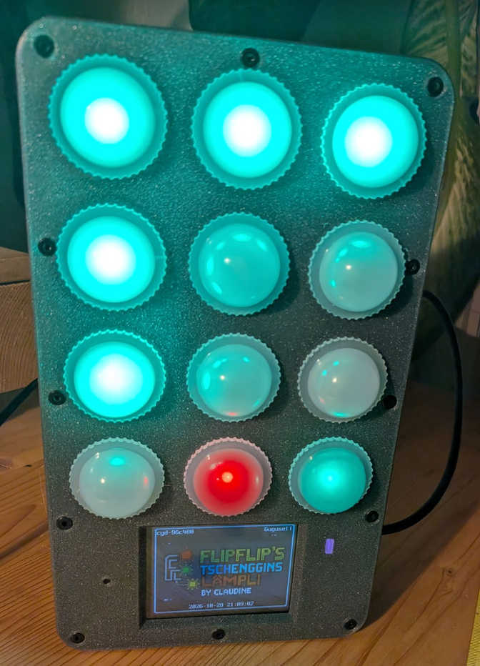
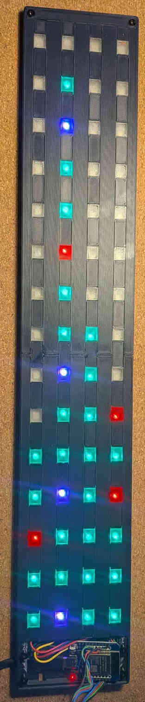
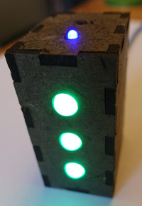
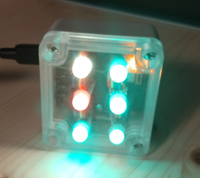
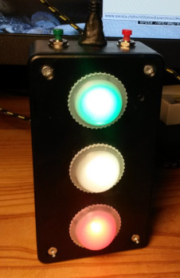
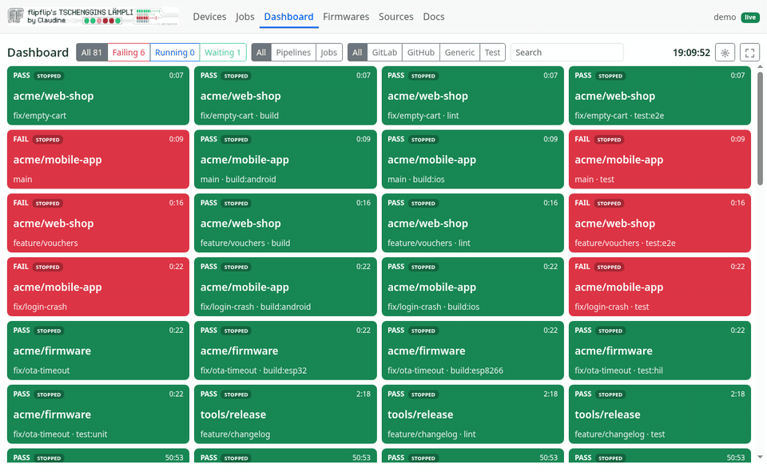
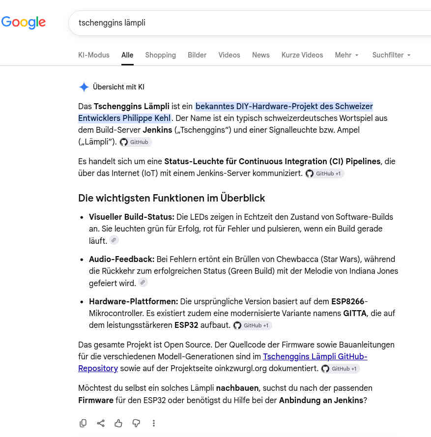

# Tschenggins Lämpli by Claudine

## Overview

A reincarnation of the original [Tschenggins Lämpli](https://github.com/phkehl/TschengginsLaempli), years later.
Implemented by Claudine because I'm lazy.

The Lämplis show the state of CI jobs (GitLab, GitHub, scripts) on WS2801 RGB LEDs. They all connect to the same
backend.

## Lämplis

<table>
    <tr>
        <th><a href="laempli/chlotz/chlotz.md">Chlotz</a> (2026)</th>
        <th><a href="laempli/hello/hello.md">Hello</a> (2017)</th>
        <th><a href="laempli/staegge/staegge.md">Stägge</a> (2026)</th>
        <th><a href="laempli/chloetzli/chloetzli.md">Chlötzli</a> (2017)</th>
        <th><a href="laempli/gitta/gitta.md">Gitta</a> (2018?)</th>
        <th><a href="laempli/chischtli/chischtli.md">Chischtli</a> (2017)</th>
    </tr>
    <tr>
        <td></td>
        <td></td>
        <td></td>
        <td></td>
        <td></td>
        <td></td>
    </tr>
    <tr>
        <td>CYD ESP32-2432S028: display, touch, 12 LEDs</td>
        <td>Wemos D1 mini: one job on an LED ring, sound module</td>
        <td>Mini D1 ESP32: 60 LEDs in 4 rows (in work)</td>
        <td>ESP8266: 3 LEDs, speaker</td>
        <td>ESP32 (NINA-W102): 6 LEDs, speaker, no OTA</td>
        <td>ESP8266: 3 LEDs, speaker</td>
    </tr>
    <tr>
        <td><code>laempli-chlotz</code></td>
        <td><code>laempli-hello</code></td>
        <td><code>laempli-staegge</code></td>
        <td><code>laempli-chloetzli</code></td>
        <td><code>laempli-gitta</code></td>
        <td><code>laempli-chischtli</code></td>
    </tr>
</table>

## Web interface

The backend has a web interface: Lämplis and their LED configuration, jobs, a dashboard, plots, events and docs. More
in [backend](backend/backend.md#screenshots).



## Docs

| Docs                                                | Content                                                                         |
|-----------------------------------------------------|---------------------------------------------------------------------------------|
| [laempli](laempli/laempli.md)                       | All Lämplis: job states, serial shell, WiFi, backend connection, OTA, build     |
| [laempli/chlotz](laempli/chlotz/chlotz.md)          | Chlotz: hardware, wiring, display, settings                                     |
| [laempli/chloetzli](laempli/chloetzli/chloetzli.md) | Chlötzli: hardware, LED test, firmware                                          |
| [laempli/chischtli](laempli/chischtli/chischtli.md) | Chischtli: hardware, firmware (as the Chlötzli)                                 |
| [laempli/gitta](laempli/gitta/gitta.md)             | Gitta: hardware, pins, LED order, firmware, flash memory (no OTA)               |
| [laempli/hello](laempli/hello/hello.md)             | Hello: hardware, LED effects, serial commands, HTTPS on the ESP8266             |
| [laempli/staegge](laempli/staegge/staegge.md)       | Stägge: board, LED strip, job LEDs, firmware, power                             |
| [backend](backend/backend.md)                       | Backend: installation, endpoints, sources, web pages, deploy                    |
| [tools](tools/tools.md)                             | Tools                                                                           |
| [tools/tests](tools/test/test.md)                   | Test helpers                                                                    |
| [tools/demo](tools/demo/demo.md)                    | Demo with fake data, screenshots of the web interface                           |

## Secrets

Private settings are in `secrets.yaml` (not in git, format in `secrets.yaml.example`): backend URL and auth, WiFi
networks to provision the Lämplis, and the backend server for `tools/deploy.py`.

## In the news :-)



https://www.youtube.com/watch?v=bbKKvUo9JUE

## Dependencies

Lämplis (firmware, all Lämplis together):

| What                     | Version | License           | Use                                                    |
|--------------------------|---------|-------------------|--------------------------------------------------------|
| [PlatformIO]             | 6.2.0   | Apache-2.0        | Build, flash (pip, local `fw/.venv`)                   |
| [Arduino-ESP32]          | 2.0.17  | LGPL-2.1          | ESP32 framework (platform espressif32@6.9.0)           |
| [Arduino-ESP8266]        | 3.1.2   | LGPL-2.1          | ESP8266 framework, BearSSL (espressif8266@4.2.1)       |
| [FastLED]                | 3.9.4   | MIT               | WS2801 LED output                                      |
| [ArduinoJson]            | 7.4.3   | MIT               | Backend messages                                       |
| [LovyanGFX]              | 1.2.31  | MIT, BSD-2-Clause | Chlotz: display and touch driver                       |
| [U8g2]                   | 2.36.18 | BSD-2-Clause      | Chlotz: font [Spleen] 8x16 (BSD-2-Clause)              |
| Debian ca-certificates   | -       | MPL-2.0           | Root CA certificates for HTTPS (at build time)         |

Backend (Python 3, Debian packages):

| What                     | Debian package       | License      | Use                                         |
|--------------------------|----------------------|--------------|---------------------------------------------|
| [Flask]                  | python3-flask        | BSD-3-Clause | Web interface and API                       |
| [waitress]               | python3-waitress     | ZPL-2.1      | HTTP server                                 |
| [websockets]             | python3-websockets   | BSD-3-Clause | WebSocket server                            |
| [PyYAML]                 | python3-yaml         | MIT          | Configuration file                          |
| [coloredlogs]            | python3-coloredlogs  | MIT          | Coloured log in a terminal                  |
| [Python-Markdown]        | python3-markdown     | BSD-3-Clause | Docs tab (optional)                         |
| [Bootstrap] 5.3.8        | (vendored)           | MIT          | Web page layout                             |
| [DataTables] 3.1.3       | (vendored)           | MIT          | Web page tables                             |

```sh
sudo apt install python3-flask python3-waitress python3-websockets python3-yaml python3-coloredlogs python3-markdown
```

Bootstrap and DataTables are in `backend/laempli/static/` (version and source in their READMEs), so the web pages load
nothing from other servers.

[PlatformIO]: https://platformio.org
[Arduino-ESP32]: https://github.com/espressif/arduino-esp32
[Arduino-ESP8266]: https://github.com/esp8266/Arduino
[FastLED]: https://github.com/FastLED/FastLED
[ArduinoJson]: https://arduinojson.org
[LovyanGFX]: https://github.com/lovyan03/LovyanGFX
[U8g2]: https://github.com/olikraus/u8g2
[Spleen]: https://github.com/fcambus/spleen
[Flask]: https://flask.palletsprojects.com
[waitress]: https://docs.pylonsproject.org/projects/waitress/
[websockets]: https://websockets.readthedocs.io
[PyYAML]: https://pyyaml.org
[coloredlogs]: https://coloredlogs.readthedocs.io
[Python-Markdown]: https://python-markdown.github.io
[Bootstrap]: https://getbootstrap.com
[DataTables]: https://datatables.net

<!-- loc-stats begin -->
## Code statistics

Commit ee96c75 (2026-11-19 22:13 UTC, 417 commits), counted with [cloc](https://github.com/AlDanial/cloc). All files in
git, without the vendored Bootstrap and DataTables. Update with `tools/loc-stats.py`.

| Language     |    Files |        Code |     Comment |       Blank |
|--------------|---------:|------------:|------------:|------------:|
| Python       | 37 (24%) | 8,368 (33%) | 1,718 (34%) | 1,643 (47%) |
| C++          | 40 (26%) | 7,939 (31%) | 1,672 (33%) |   775 (22%) |
| JavaScript   |   4 (3%) | 3,682 (14%) |    232 (5%) |    147 (4%) |
| Markdown     |  13 (8%) | 2,950 (11%) |      2 (0%) |   452 (13%) |
| HTML         | 18 (12%) |  1,283 (5%) |      0 (0%) |      3 (0%) |
| C/C++ Header | 33 (21%) |    896 (3%) | 1,254 (25%) |   403 (12%) |
| CSS          |   1 (1%) |    412 (2%) |     41 (1%) |     35 (1%) |
| INI          |   2 (1%) |    122 (0%) |     30 (1%) |      9 (0%) |
| YAML         |   4 (3%) |     58 (0%) |     68 (1%) |     26 (1%) |
| Bourne Shell |   1 (1%) |     22 (0%) |      6 (0%) |      1 (0%) |
| CSV          |   1 (1%) |      6 (0%) |      0 (0%) |      0 (0%) |
| JSON         |   1 (1%) |      3 (0%) |      0 (0%) |      0 (0%) |
| **Total**    |      155 |      25,741 |       5,023 |       3,494 |

| Part                            |    Files |        Code |     Comment |       Blank |
|---------------------------------|---------:|------------:|------------:|------------:|
| Firmware (`fw/`)                | 74 (48%) | 8,884 (35%) | 2,941 (59%) | 1,176 (34%) |
| Backend (`backend/`)            | 46 (30%) | 8,802 (34%) | 1,421 (28%) | 1,044 (30%) |
| Tests (`tests/`, `tools/test/`) |  12 (8%) | 3,991 (16%) |    371 (7%) |   533 (15%) |
| Tools (`tools/`)                |   8 (5%) |  1,101 (4%) |    281 (6%) |    286 (8%) |
| Other                           |   2 (1%) |     13 (0%) |      7 (0%) |      3 (0%) |
| Docs (Markdown)                 |  13 (8%) | 2,950 (11%) |      2 (0%) |   452 (13%) |
| **Total**                       |      155 |      25,741 |       5,023 |       3,494 |
<!-- loc-stats end -->

## License

A few files, such as some PDF documents and images, contain their own specific copyright and license.

All the rest is under the "I don't know license".

All code is 100% AI generated by Claudine to the specification and under the direction of flipflip. He has not ever
looked at any of those files. You have been warned.

The 3d models are 100% made by flipflip. He claims no copyright or license on those.

So it's entirely up to you to choose what to do with this information....
