# Tschenggins Lämpli backend

The Lämplis connect to the backend. It gets the job events (GitLab, GitHub, scripts), keeps the LED config and the
settings of each device, sends the LED states to the devices and serves the firmware updates. It has a web interface.
The Lämplis: [laempli/laempli.md](../laempli/laempli.md).

## Installation and configuration

`backend/tschenggins-laempli.py`: Python, [Flask](https://flask.palletsprojects.com/) and
[waitress](https://docs.pylonsproject.org/projects/waitress/). The implementation is in the package
`backend/laempli/`. See `backend/tschenggins-laempli.py --help`.

Dependencies (Debian packages):

```sh
sudo apt install python3-flask python3-waitress python3-websockets python3-yaml python3-coloredlogs python3-markdown
```

Configuration: `backend/tschenggins-laempli.yaml` (listen address, port, data directory, heartbeat interval, log
level, GitLab webhook signing tokens, GitHub webhook secrets, generic job tokens, ignored GitLab projects and GitHub
repositories, days to keep raw events, housekeeping, editors).
Relative paths are relative to this file. Another file: `--config <file>`. Git tracks only the example; make your copy
first:

```sh
cp backend/tschenggins-laempli.yaml.example backend/tschenggins-laempli.yaml
```

## Endpoints

| Endpoint                    | Method | Function                                                                    |
|-----------------------------|--------|-----------------------------------------------------------------------------|
| `/`                         | GET    | Redirect to `/web`                                                          |
| `/web`                      | GET    | Web interface (single page app), the URL hash has the view: `/web#/devices` |
| `/web/devices`              | GET    | Web interface, tab Devices (ID, WiFi, signal, uptime, IPs, firmware, LEDs)  |
| `/web/dashboard`            | GET    | Tab Dashboard: tiles of all jobs, newest first, see [Dashboard](#dashboard) |
| `/web/jobs`                 | GET    | Tab Jobs, Jobs: all jobs (path "source → name → ...") with result, status,  |
|                             |        | info, link to the events of the job (GitLab, GitHub, generic)               |
| `/web/plots`                | GET    | Tab Jobs, Plots: job states over time, see [Plots](#plots)                  |
| `/web/firmwares`            | GET    | Tab Firmwares: newest firmware file of each name                            |
| `/web/sources`              | GET    | Tab Sources, overview: events, ignored events, last event of each source;   |
|                             |        | second navbar with the sources (pages below)                                |
| `/web/docs/<name>`          | GET    | Tab Docs: the docs as HTML (see [Docs tab](#docs-tab))                      |
| `/web/docs/file/<path>`     | GET    | Image of the docs (only the ones the docs use)                              |
| `/web/device/<ID>`          | GET    | Device page: LED config (form) with the LED states, settings (form)         |
| `/web/device/<ID>`          | POST   | Set LED config (form, editors)                                              |
| `/web/device/<ID>/settings` | POST   | Change device settings (form, editors)                                      |
| `/api/devices`              | GET    | Devices as JSON                                                             |
| `/api/state/<ID>`           | GET    | State of a device as JSON                                                   |
| `/api/settings/<ID>`        | GET    | Device settings (values, options, pending) as JSON                          |
| `/api/settings/<ID>`        | POST   | Change device settings (JSON object, editors)                               |
| `/api/firmware`             | GET    | Newest firmware of each name as JSON                                        |
| `/api/firmware/<file>`      | GET    | Firmware file for OTA (firmware before 2026-11-07)                          |
| `/web/gitlab`               | GET    | Sources, GitLab: log of all GitLab pipeline and job events (pages)          |
| `/web/gitlab/rows`          | GET    | Rows of the GitLab events table (HTML in JSON, parameters as the log API)   |
| `/api/gitlab`               | GET    | GitLab data as JSON                                                         |
| `/api/gitlab`               | POST   | GitLab webhook (pipeline, job, push and tag push events; others ignored)    |
| `/api/gitlab/log`           | GET    | GitLab pipeline and job events as JSON (pages, see below)                   |
| `/api/jobs`                 | GET    | All jobs as JSON                                                            |
| `/api/plots`                | GET    | State changes of the jobs as JSON, see [Plots](#plots)                      |
| `/api/log/<id>`             | GET    | One event log entry: `{"id", "source", "entry"}` (cause of a plot point)    |
| `/api/jobs/remove`          | POST   | Remove a branch, `{"path": [<source>, <project>, <ref>]}` (editors)         |
| `/api/job?path=<JSON>`      | GET    | One job as JSON, e.g. `?path=["gitlab","g/p","main"]` (404: no such job)    |
| `/api/dashboard`            | GET    | Dashboard config as JSON: `{"sticky": [{"path": [...], "name": ""}, ...]}`  |
| `/api/dashboard`            | POST   | Set the dashboard config (JSON as GET, editors)                             |
| `/web/github`               | GET    | Sources, GitHub: log of all GitHub workflow run and job events (pages)      |
| `/web/github/rows`          | GET    | Rows of the GitHub events table (HTML in JSON, parameters as the log API)   |
| `/api/github`               | GET    | GitHub data as JSON                                                         |
| `/api/github`               | POST   | GitHub webhook (workflow run, job and delete events, ping; others ignored)  |
| `/api/github/log`           | GET    | GitHub workflow run and job events as JSON (pages, see below)               |
| `/web/generic`              | GET    | Sources, Generic: log of all generic job updates (pages)                    |
| `/web/generic/rows`         | GET    | Rows of the generic updates table (HTML in JSON, parameters as the log API) |
| `/api/generic`              | GET    | Generic job data as JSON                                                    |
| `/api/generic/<names>`      | GET    | Generic job as JSON                                                         |
| `/api/generic/<names>`      | POST   | Set a generic job (token)                                                   |
| `/api/generic/<names>`      | PUT    | Same as POST                                                                |
| `/api/generic/<names>`      | DELETE | Remove a generic job (token)                                                |
| `/api/generic/log`          | GET    | Generic job updates as JSON (pages, see below)                              |
| `/web/test`                 | GET    | Sources, Test: change the test jobs (select result and status, then Send)   |
| `/web/test/<name>`          | POST   | Set status and/or result of a test job, one event (form, editors)           |
| `/api/leds/<ID>`            | GET    | LED config and LED states as JSON                                           |
| `/api/leds/<ID>`            | POST   | Set LED config (JSON list, editors)                                         |
| `/api/device/<ID>/update`   | POST   | Start firmware update: connected, newer firmware, none runs (editors)       |
| `/api/device/<ID>/sound`    | POST   | Play a sound, device connected (JSON `{"sound": <name>}`, editors)          |
| `/api/device/<ID>/led`      | POST   | LED test, device connected (JSON `{"mode": ..., "led": n}`, editors)        |
| `/ws/device?device=<ID>...` | WS     | Device connection: stream events to the device, reports, firmware update    |

Event log API (`/api/<source>/log`, also `/web/<source>/rows`): parameters `start` (default 0), `length` (default
100, max. 1000), `q` (search: all words, `"quoted words"` as one, in any value or the local time, no case),
`sort` (`<column>.<asc|desc>,...`, column: number of the table column or entry key, e.g. `sort=project.asc`;
default: newest first), `since` and `until` (Unix time [s]), `kind` (GitLab: `pipelines` or `jobs`, GitHub: `runs`
or `jobs`), `state` (e.g. `failed,running`: the states of the plots, see [Plots](#plots)), `ignored=1` (also the
ignored events; default: without them). Result: `{"total": <events of the source>,
"filtered": <events found>, "events": [<entry>, ...]}` (rows: `"rows": [<tr> HTML, ...]`). Example:
`curl '<backend URL>/api/gitlab/log?q=main%20failed&length=1000'`.
| `/ws/web`                   | WS     | Web pages: "changed" events (live updates of the pages)                     |

The WebSocket endpoints (`/ws/...`) are on their own port (`ws_port`, default `port` + 1), see
`backend/laempli/wsserver.py`. Messages are JSON: `{"event": <name>, "data": {...}}`. The device gets the events
`hello`, `state` (also on change), `time` (each 15 s), `settings` (changes from the web page), `update`, `sound` and
`led` (buttons on the web page), and sends `report` events (RSSI, uptime, free heap, settings; the first one of a
connection also the CPU name and the heap size: "Free heap: <free> of <size> KiB" on the pages) after each heartbeat
and each settings change: one connection in both directions, also for TLS. The web pages get the page again when a shown
thing changes and replace the changed parts (tables keep sort and search); a badge "live" in the navbar shows the
connection. Without it ("offline"), they do the same at each reconnect try, up to each 30 s.

Only Lämplis connect: the energy monitor (EnergyMonByClaudine) talks a similar protocol, so a wrong URL in its
settings must not make it a device here, and the other way round.

- The backend accepts only the device types of `DEVICE_TYPES` in `backend/laempli/firmware.py` (chlotz, hello,
  staegge, chloetzli, gitta, chischtli) and `app=laempli` (a missing `app`: firmware before 2026-11-12). Else HTTP 403 before the
  WebSocket handshake, and a warning in the log, at most once per hour for each device and reason. A new Lämpli type
  must go into `DEVICE_TYPES`.
- The device takes nothing before a hello with `"server": "laempli"`. A hello of another server (the energy monitor
  sends `"server": "energymon"`) closes the connection (close code 1008), the state is "wrong server: energymon", and
  the next try waits the longest retry time (60 s).

## Reverse proxy, authentication

The backend has no authentication; use the reverse proxy for authentication and TLS. The proxy sends two headers:

- `X-Forwarded-Prefix`: the path of the backend on the proxy, e.g. `/laempli`. The backend makes its URLs (links,
  redirects) with it. The proxy can pass the path to the backend with or without this prefix.
- `X-Forwarded-User`: the logged in user. Only users in the `editors` list can change the LED config and the settings
  (endpoints marked "editors" in [Endpoints](#endpoints), else status 403). Users in `device_editors` (user name ->
  list of device IDs) can change only these devices: the endpoints `/web/device/<ID>...`, `/api/leds/<ID>`,
  `/api/settings/<ID>` and `/api/device/<ID>/...`. For other users, the device page shows the forms disabled and a
  "read only" badge in the headers of the LEDs and Settings cards.

The backend trusts these headers from all clients. Thus it listens on `127.0.0.1` (the default), with the proxy on the
same host.

## Data and housekeeping

Data: the directory `data/` has one file `laempli_<device ID>.json` for each device (device info, LED config and device
state), the firmware files in `fw/`, the raw events and the event logs of all sources in `events.sqlite` (SQLite, WAL
journal: also the files `events.sqlite-wal` and `events.sqlite-shm`) and the sticky jobs of the Dashboard in
`dashboard.json`. Git tracks only `data/.gitkeep`. The raw events are the only stored source data: at start, the backend
replays them to make the source states, the event logs and the jobs again. Old raw event files (`gitlab_raw.jsonl`,
`github_raw.jsonl`, `generic_raw.jsonl`, `test_raw.jsonl`) are imported once at start and renamed to `*.imported`
(remove them by hand). Read the events with the sqlite3 tool (Debian package sqlite3), e.g.
`sqlite3 data/events.sqlite "SELECT datetime(time, 'unixepoch'), event FROM events WHERE source = 'gitlab'"`. Details:
`backend/laempli/eventdb.py`. The jobs are in memory only (`/api/jobs` gives all of them, details:
`backend/laempli/jobs.py`).

Housekeeping: a thread runs every `housekeeping_interval` seconds (default 3600) and removes:

| What                                      | Config              | Default |
|-------------------------------------------|---------------------|---------|
| Raw events and event log older than       | `events_keep_days`  | 90 days |
| Jobs without events (LED then blinks) in  | `events_keep_days`  | 90 days |
| Firmware files, all but the newest N of each name | `firmware_keep` | 10 |
| Devices (file and LED config) not connected for | `devices_keep_days` | 365 days (0 = never) |

Details: `backend/laempli/housekeeping.py`.

## GitLab

In the project (or group) settings, add a webhook with the URL `<backend URL>/api/gitlab` and the triggers "Pipeline
events", "Job events", "Push events" (all branches) and "Tag push events" (the backend ignores other events). Job events
update the job list of a pipeline between its pipeline events. Of the push events, the backend only uses the ones of a
deleted branch or tag: it removes its pipelines (see [Deleted branches](#deleted-branches)). Let GitLab generate a
signing token (`whsec_...`) and add it to the list `gitlab_signing_tokens` (one token per webhook). The backend checks
the `webhook-signature` header (HMAC-SHA256, one token must match, at most 5 minutes old). Events with a bad signature
get 401. With an empty list, the backend accepts all events. The backend keeps the newest main pipeline (with its jobs)
of each ref (branch, tag) of each project and, separately, the newest downstream pipeline (child or multi-project
pipeline) of each trigger job. Each of them, and each job name in them, is a job. A merge request pipeline is on its
source branch (not on `refs/merge-requests/<iid>/head`). Result of a pipeline or job: success is PASS (WARN if "passed
with warnings" or a failed job with allow_failure), failed is FAIL, canceled is UNKNOWN. Status: a pipeline is RUNNING
while some of its jobs or downstream pipelines run (or wait for a runner). When it only waits for manual jobs (also in a
downstream pipeline, which GitLab shows as "running"), it is WAITING.
Ignored projects: the list `gitlab_ignored_projects` (project path, e.g. `group/project`, or a pattern with `*`, `?`,
`[...]`). The backend stores their pipeline and job events and shows them on the GitLab page as ignored ("project
ignored"), but makes no jobs from them (also no plot lines). A change of the list applies at the next start (the
replay). Details: `backend/laempli/gitlab.py`.

## GitHub

In the repository (or organisation) settings, Webhooks, add a webhook:

- Payload URL `<backend URL>/api/github`. With basic auth in the reverse proxy, put the user and password in the URL:
  `https://<user>:<password>@<host>/<prefix>/api/github`. github.com must reach it (public URL).
- Content type `application/json` (form also works).
- Secret: a random text (e.g. `openssl rand -hex 20`). Add it to the list `github_webhook_secrets` and restart the
  backend. The backend checks the `X-Hub-Signature-256` header (HMAC-SHA256, one secret must match). Events with a bad
  signature get 401. With an empty list, the backend accepts all events.
- Events: "Let me select individual events", then "Workflow runs", "Workflow jobs" and "Branch or tag deletion" (the
  backend ignores others).

GitHub sends a "ping" at once. On the webhook page, "Recent Deliveries" shows if it arrived (response 200). The backend
keeps the newest run (with its jobs) of each workflow of each branch of each repository (pull request runs: the source
branch). Each workflow, and each job name in it, is a job. Ignored repositories: the list `github_ignored_repos`
(`owner/repo` or a pattern), as for GitLab. Details: `backend/laempli/github.py`.

## Deleted branches

When GitLab (push event) or GitHub (delete event) says that a branch or tag is deleted, the backend removes its
pipelines (GitLab) or workflow runs (GitHub) and all their jobs: they go away from the Jobs page, the Lämpli LEDs and
the project rows of the Stägge. Late events of a pipeline that was still running are ignored. A new pipeline on a
branch with the same name brings it back. The source pages log the removal (kind "deleted").

GitLab sends no push events for "Delete merged branches" and for a push of more than 3 branches. For these (and for
branches deleted before the webhook had these events), editors can click the Remove button (trash icon) on the
Jobs page: on the pipeline row of a GitLab ref, or on a workflow row of a GitHub branch (it removes the whole
branch). The source pages log it (kind "removed"). Both stay after a restart (the raw events keep them).

## LED config

On the Devices tab, click the pencil (first column) or the tab of the device in the second tab bar (Overview: the table,
then one tab per device, also on each device page). The device page has the card Device first (status and the values of
the Devices table), then the LED config: it shows the LEDs on the left, in the arrangement of the device (the device
sends its number of LEDs, numbered from 1 as on the Chlotz): Chlotz 3 columns, Gitta 2 columns, Chlötzli, Chischtli
and Hello 1 column, Stägge one line per row, other types 4 columns. The Chlötzli and the Chischtli (LED 1 at the bottom
with "Reverse LEDs" off) and the Stägge (LED 1 at the right with "Reverse LEDs" on) and the Gitta (LED 1 at the bottom right with "Reverse LEDs" on) follow the device
setting. Each LED shows its result and status, the (i) at the top
right has the job info with the full job path (point to it; it stays open while the mouse is on it, with a link to the
job). Click an LED: the right side shows its fields (URL hash `?led=<n>`, Stägge `?row=<n>`). A
dashed orange border marks LEDs with unsaved changes. Save saves all LEDs, Revert discards the changes. The fields of
one LED, one line each (label, then input): an optional name (short label for the Chlotz display), a chain of lists for
the job path (the "(events)" link opens its events), the max. age (see [LEDs: job
status](../laempli/laempli.md#leds-job-status)) and the sounds, one line per event (see [Job
sounds](../laempli/laempli.md#job-sounds)). The first list has the sources, each next list the things in the selected
one. "(this pipeline)" (GitLab) stops the path there: the LED shows the main pipeline (at the ref) or the downstream
pipeline (at the trigger job). "(this workflow)" (GitHub) stops at the workflow: the LED shows its newest run. "(this
job)" (generic) stops at a job that has more names below it. The lists have the jobs that sent events. "(off)" means the
LED is off. A saved name without events stays in its list. Save is active only with changes. Leaving the page (links,
browser) with unsaved changes asks first. The backend sends the LED states (status, result and info of the job) to the
device after each event and each config change. Script use: `curl -X POST -H 'Content-Type: application/json' -d
'[{"path": ["gitlab", "core/release-config", "main", "yocto_trigger"], "name": "Yocto"}, null]' <backend
URL>/api/leds/<ID>` (optional `"max_age"`: seconds or text as on the page; optional
`"sounds"`: `{"fail": "Tetris1", "pass": "fx", "broken": ..., "fixed": ...}`, a melody name or `fx` for the sound
effect). Older configs (project, ref, downstream, job; status and result timeouts: the result timeout becomes the
max. age) are converted at start and by the API. Details: `backend/laempli/leds.py`.

The sound lists have the sounds that the device reports with its settings options: the melodies (with their length, e.g.
`Tetris1 (24s)`) and (Hello) the sound effect. A sound that the device does not have shows as "(not on device)"; the
device ignores it.

LED test (buttons below the LEDs, editors, device connected, only with a firmware that has it): Red, Green, Blue,
White, Off (all LEDs one colour), Rainbow, Find LED n (only the selected LED blinks white, the others are off; Stägge:
Find row n, the whole row), Normal (job states again). The device shows the test for 60 s, then the job states again,
so a closed page does not leave the LEDs in a test. The LEDs use the LED brightness setting. The badge "LED test: ..."
next to the card title comes from the device report: it shows the test on all open pages. Script use: `POST
/api/device/<ID>/led` with `{"mode": "red|green|blue|white|off|demo|find|normal", "led": <index from 0>}` (`"row"`
instead of `"led"` for project rows; only for find). The backend sends a "led" event to the device (see
`fw/src/common/ledremote.cpp`).

Devices with project rows (Stägge): the device page has the fields of a row (click a row or an LED) instead of the
fields of an LED: on the left a list with the GitLab and GitHub projects and the max. age of a pipeline, one line each;
on the right (below on narrow screens) the pipelines of the row. The LEDs show narrow badges: first letter of result and
status (e.g. P, S for PASS, STOPPED), the tooltip has the pipeline, the (i) below the badges its info. The pipelines
list has: LED number, result and status, name. The row shows all pipelines of the project, one LED per pipeline, without
the stages and jobs in them (GitLab: main pipeline of each ref, GitHub: each workflow of each branch). LED 1 has the
oldest pipeline, a pipeline moves to the new end when a new run starts. Pipelines without change for the max. age
(default 7 days, 0: no limit) are not shown; if the row is full, the oldest are not shown. Script use: `/api/leds/<ID>`
with `[{"path": ["gitlab", "core/sw/common/fpxx"], "max_age": "7d"}, null, ...]`. Details: `backend/laempli/leds.py`.

## Device settings

The device page also has a card "Settings" with the device name and the settings of the device
type (Chlotz: display and LED settings, Stägge, Chlötzli, Chischtli and Gitta: LED settings, Hello: ring and bow brightness, reverse
LEDs; not WiFi
or backend). They can change on the
device and on the page; each side shows the other's changes:

- The device has the values. It sends them to the backend when it connects, after each change and each heartbeat. The
  Devices tab and the device page show the name.
- A change on the page is "pending" (yellow) until the device has it. The backend sends it to the device at once, or
  when the device connects; the page shows "not synced". The device applies and saves it and reports back; then the
  page shows "synced with device" (it reloads itself if the device is connected).
- A setting changed on both sides while the device was not connected: the value from the page wins.
- The device needs a firmware with this function; before the first report, the card shows "No settings from the device
  yet".

Script use: `curl <backend URL>/api/settings/<ID>` (values, options, pending), `curl -X POST -H 'Content-Type:
application/json' -d '{"dim_level": 30}' <backend URL>/api/settings/<ID>`. Details: `backend/laempli/settings.py`.

## Web pages and logging

Web pages: [Bootstrap](https://getbootstrap.com) layout (light or dark, as the browser setting). The tables use
[DataTables](https://datatables.net) (sort, search and pages; the settings stay over the live updates, a page load
starts with the defaults; nothing is saved in the browser; search field
and number of rows above the table at the left, with a "show all" link to clear the search; rows per page (100, 200,
500, 1000, all; default 200) and the first, previous, next, last buttons at the right; the Firmwares table has no pages).
The event tables of the sources get one page at a time from the server (search and sort over all events, no "all"); a
live update loads the page again, at most each 2 s. GitLab and GitHub event tables: filters in front of the search
field: kind (all, pipelines or runs, jobs), states (several), "Ignored" (show the ignored events: old pipelines,
deleted branches, ignored projects; hidden by default), also in the URL hash (`?kind=jobs&state=failed&ignored=1`).
They have no "show all" link. The Jobs table has filters for the result and the status (several each, in the hash as
`?result=FAIL,WARN&status=RUNNING`). Markup: `backend/laempli/templates/tablefilters.html`.
The Sources overview shows the number of ignored events of each source.
Number and time columns are right aligned. A source table without events shows its head and "No data for the past
<n> days". The "live" badge blinks when data from a Lämpli comes in, also the status badges of that device (Devices
table, device page). In the Jobs and source tables,
long text ends in "…" (the tooltip has the full text), so the tables need no horizontal scroll. Both are vendored in
`backend/laempli/static/bootstrap/` and `backend/laempli/static/datatables/` (MIT license, version and source in their
READMEs), so the pages need no internet access and load nothing from other servers. The favicon
(`backend/laempli/static/favicon.png`) is inlined in each page. Times in the tables are relative (time ago as
d:hh:mm:ss, leading zero parts left out, e.g. "1:07:38:08", "7:38:08", "8:08", "0:05", updated each second; device uptime in the same format), the tooltip shows the date
and time. The card footers have links to the same data as JSON (GET API, see [Endpoints](#endpoints); the tooltip tells
what it is).

The web interface is a single page app (`backend/laempli/static/laempli.js`). Each view is a server page
(`/web/<route>`). The script gets the page and replaces `<main>`, without a page load. A loading animation shows when
this takes longer than 150 ms. The URL hash has the view, so the links and the back button work:

| Link                            | View                                                                          |
|---------------------------------|-------------------------------------------------------------------------------|
| `/web#/devices`                 | Tab Devices (also `jobs`, `firmwares`, `sources`, `gitlab`, `github`, ...)    |
| `/web#/jobs?q=fpxx&sort=4.desc` | Tab Jobs with search and sort order (column number from 0)                    |
| `/web#/device/<ID>`             | Device page                                                                   |
| `/web#/device/<ID>?led=3`       | Device page, fields of LED 3 (Stägge: `?row=2`)                               |

New version (deploy): each page has the version of the scripts and styles (`data-version`, a hash of the files, also
in their URLs: `?v=<version>`). When a page from the server (other view, live update) has another version, the browser
loads the whole page again (same view), except with unsaved changes: then at the next page from the server.

A `/web/<route>` link also works: its URL changes to the hash form. A link without search or sort order shows the
table without search and in the order of the server. Each save button saves its form only: unsaved changes in the
other form stay. With unsaved changes, the page asks before it goes to another view. Without JavaScript, the
`/web/<route>` pages and forms work as normal pages.

### Screenshots

From the [demo](../tools/demo/demo.md) (fake GitLab, 3 fake Lämplis). Dashboard (live changes):

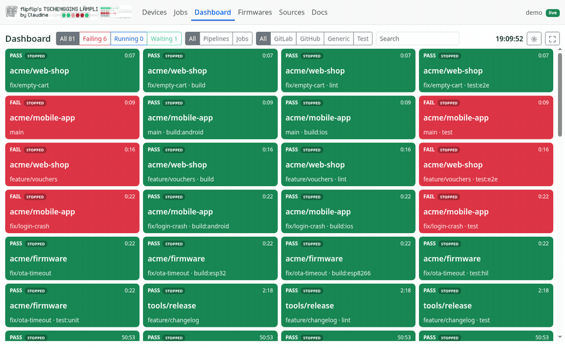

Device pages: LEDs of the Chlotz (live), Chlotz, Hello and Stägge:

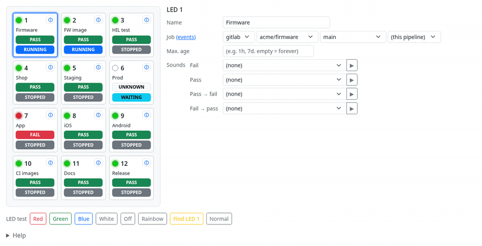

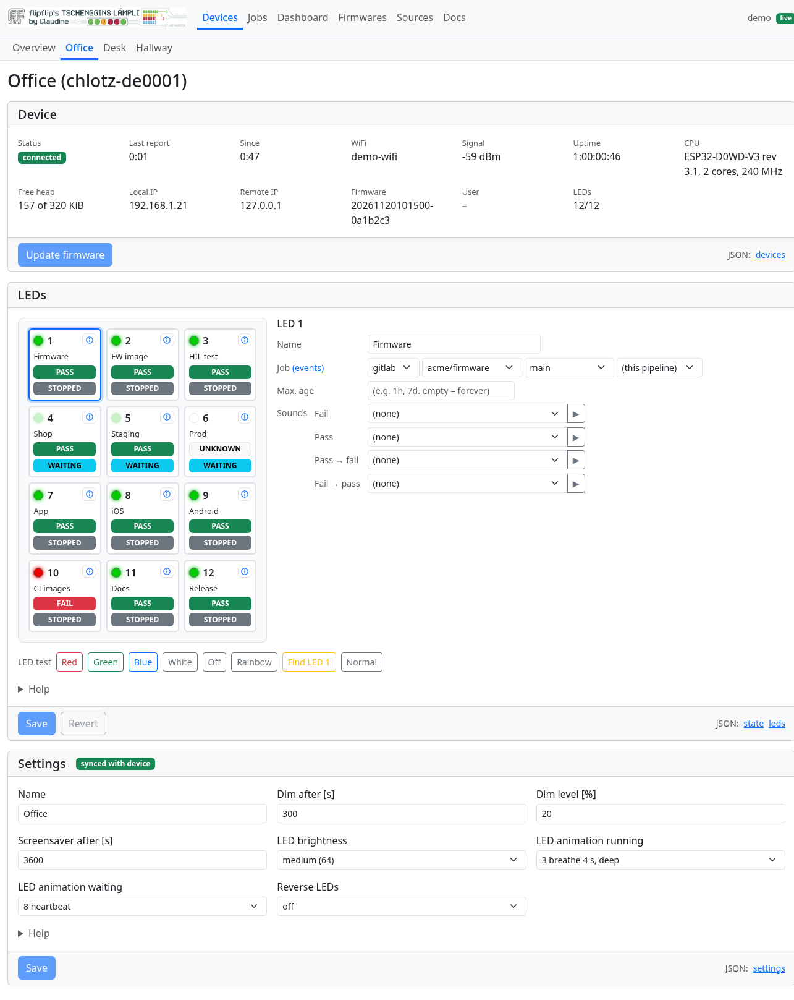 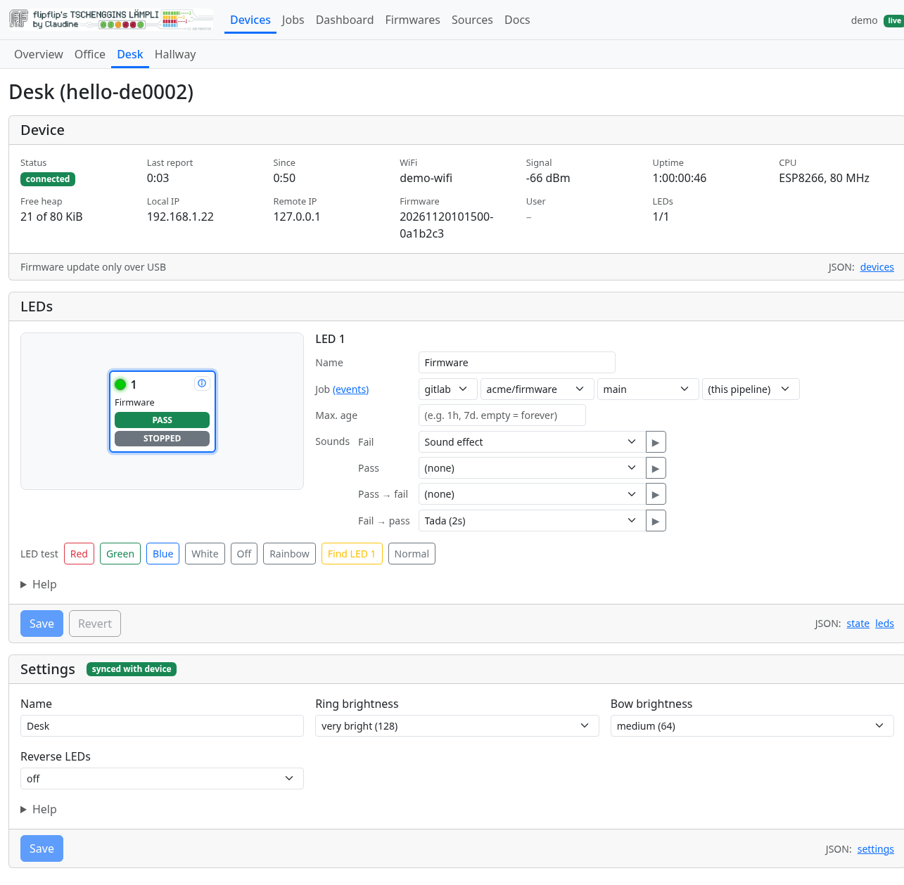
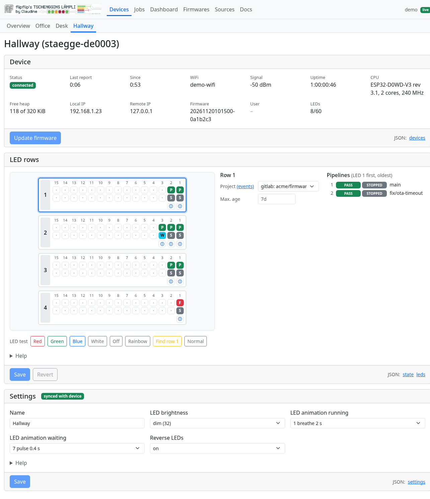

Devices, Jobs, Plots, GitLab events, Sources:

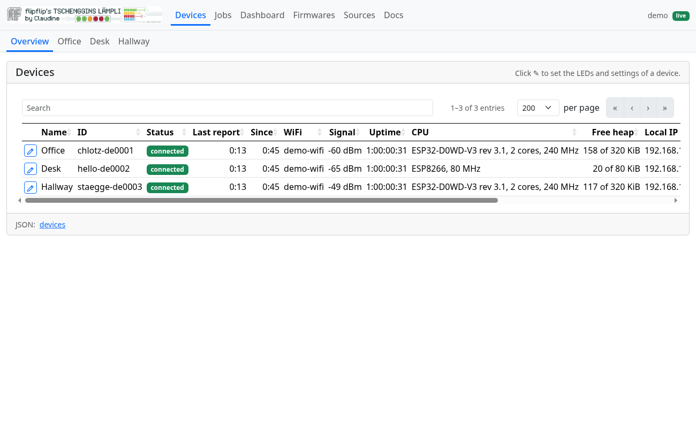 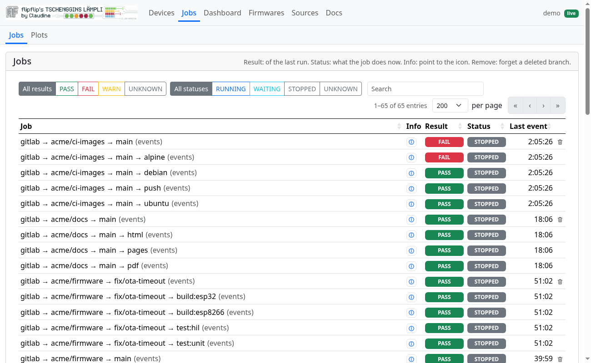
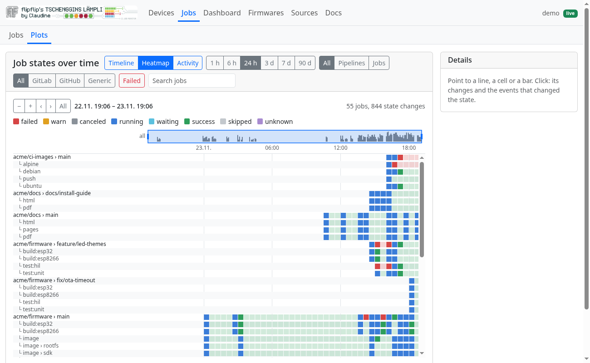 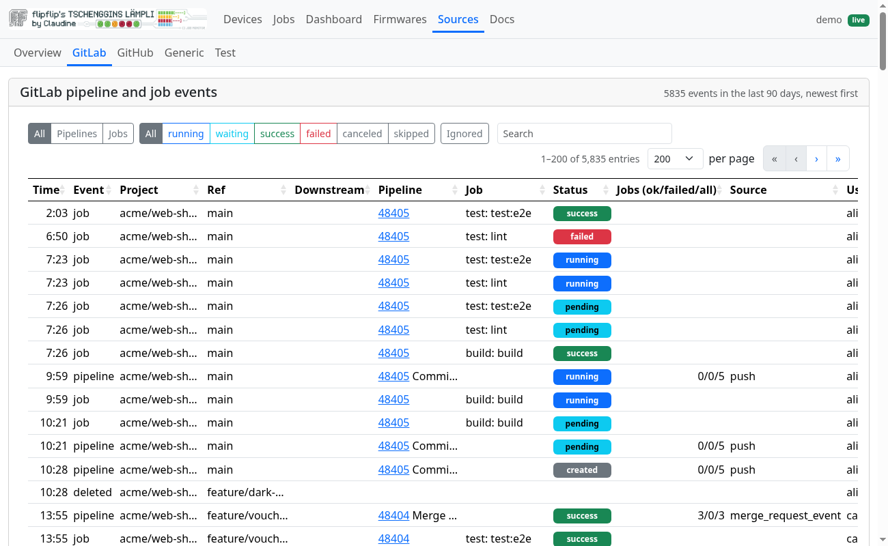
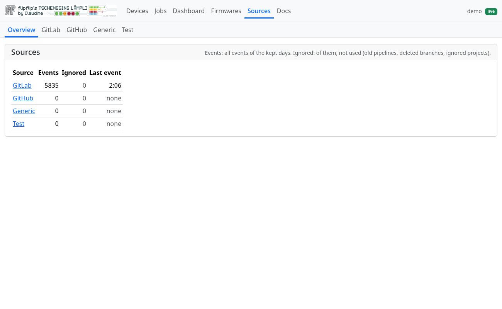 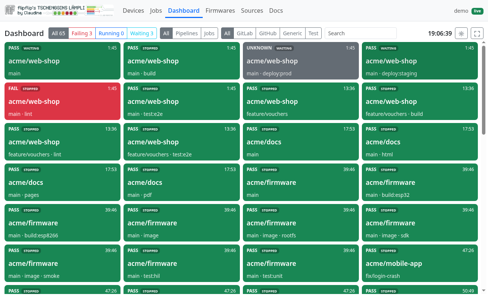

### Dashboard

The Dashboard tab shows one tile per job (pipelines and jobs of all sources), the newest change first, in a scroll area
below the header (the page itself does not scroll; 1 minute after the last scroll it goes back to the top); at most 400
tiles, the last cell counts the others ("+N older"). Tile colour: result (PASS green, FAIL red, WARN yellow, UNKNOWN
grey); running: moving stripes, waiting: pulse. For touch screens, a tap (click) on a tile zooms it to the centre of the
window, above the other tiles (they go on as before): the full path, result, status, times, the info of the job (from
`/api/job`) and a button to open the job link in a new browser tab. A zoomed pipeline also shows its jobs and downstream
pipelines (downstream first, then by name; all of them, the selectors do not apply) as small boxes in the tile colours;
they change live, and a tap on one zooms that job (a tap on it or Escape goes back to the pipeline). A tap elsewhere on
the zoomed tile, Escape or 1 minute closes it; one tile at a time. Live updates without page load: a changed tile moves
to the front (the others slide), new tiles grow, a change flashes, a change to FAIL or WARN shakes and glows red, FAIL
or WARN to PASS gives a green burst; a result change also shows a message at the bottom right for 8 s. The header has
selectors: state (All, Failing: FAIL or WARN, Running, Waiting; with the counts; several), kind (All, Pipelines: GitLab
pipelines and GitHub workflow runs, Jobs: the jobs in them and the generic and test jobs; one), source (several), a
search, then the clock, the gear button and the fullscreen button. Sticky jobs (gear button, dialog: "Add job", then the
lists of the job as in the LED config and an optional name (on the tile instead of the project name, the path below it),
order with ↑ ↓, ✕ removes; Save for editors): always first, in this order, with a border and a pin, also jobs without
data yet (grey); the selectors apply to them too. One list for all dashboards, in `data/dashboard.json`, a change shows
at once on all open dashboards.

For a big screen: the fullscreen button (black, bigger tiles), or the kiosk link `<backend URL>/web#/dashboard?full=1`
(no navbars, black; e.g. for a browser in kiosk mode: real fullscreen needs a click). The screen stays on while the
dashboard is open (wake lock, needs https or localhost), the mouse cursor hides after 3 s in fullscreen and kiosk mode.
Selectors in the hash: `?state=failing,running&kind=jobs&src=gitlab,generic&q=core` (also with `full=1`). With
"reduce motion" in the system settings, the tiles do not move or flash.

### Plots

The Jobs tab has two sub-tabs: Jobs (the table) and Plots: the state changes of the jobs over time, from the event
logs of GitLab, GitHub and the generic jobs (`backend/laempli/history.py`). Each event with a job state is a point (a
change: the same state again gives no point), the job keeps its state until its next point. The states are those of
the events (e.g. GitLab "pending" is "waiting"), not the LED states (no timeouts). Three versions (default: Heatmap): Timeline (one line
per job, coloured by state), Heatmap (one line per job, one cell per time step, the worst state in the step; faint:
no change), Activity (state changes per time step, stacked by state). Selectors: time range (1 h to
`events_keep_days`), all, pipelines or jobs, sources, only jobs that failed, search (all words in the job path).

Layout: zoom and pan buttons with the shown time range, an overview of the whole time range (the shown range is a
window: drag it to move, drag its edges to zoom, click beside it to move there), the time axis (with the time of the
mouse position), the lines in a scroll box (down to the bottom of the window; only the visible lines are drawn), the
details panel at the right (below on narrow screens). Controls: the wheel scrolls the lines, Ctrl + wheel (touchpad
pinch) zooms at the mouse, Shift + wheel (sideways swipe) moves in time, left drag moves, Shift + left drag zooms to a
time range, middle drag moves, double click zooms in; keys (click the plot first): + and - zoom, left and right move,
0 shows all, Esc closes the details. The line under the mouse has a band and a bold label, the bar or cell an
outline; the item in the panel keeps a blue outline. Click a label: the changes of that job; a bar: the job and the
event that changed the state; a cell or a time step: its events. The panel keeps a stack: "‹ Back" goes one level up.
An event shows all its fields, the previous and next change of the job, links to GitLab or GitHub, to the events of
the job, and "Plot this pipeline and its jobs" (sets the search, the browser Back button goes back). New events load
the plot again (at most each 10 s). Selectors in the hash:
`?v=timeline&range=604800&kind=pipelines&src=gitlab&failed=1&q=main`. Code: `backend/laempli/static/plots.js`.

`/api/plots`: parameters `since`, `until` (Unix time [s], default: the last 24 h), `kind` (`pipelines` or `jobs`),
`src` (e.g. `gitlab,github`), `failed=1`, `q`. Result: `{"since", "until", "now", "states": [<name>, ...], "series":
[{"path": [...], "kind": "pipeline" or "job", "points": [[<time>, <state index>, <log entry ID>], ...]}, ...],
"points": <number>, "truncated": <more than 200000 points>}`. The log entry IDs change at each start of the backend.

### Docs tab

The Docs tab shows these Markdown files of the repository as HTML, one tab each in its second navbar:

- `README.md` (Overview)
- `laempli/laempli.md` (Lämplis)
- `laempli/chloetzli/chloetzli.md`
- `laempli/chischtli/chischtli.md`
- `laempli/gitta/gitta.md`
- `laempli/hello/hello.md`
- `laempli/chlotz/chlotz.md`
- `laempli/staegge/staegge.md`
- `backend/backend.md`

The list is `DOCS` in `backend/laempli/docs.py`. The backend renders them once at start (python3-markdown; without it
the tab shows a note): after a change of a file, restart the backend (the deploy does it). Links between these files go
to their tab, also to a section (heading IDs as on GitHub, `#/docs/<name>?sec=<id>`); links to other files are plain
text; web links open a new browser tab. The images of the docs are served by `/web/docs/file/<path>`.

Logging: as systemd service, the backend writes lines with `<n>` priority prefixes to the journal. In a terminal, it
uses coloured lines (coloredlogs). Set `log_level: debug` to log each request.

## Development

The devices must reach this host:

```sh
backend/tschenggins-laempli.py                             # serves data/fw/ firmware for OTA
python3 -m unittest discover -s tests                      # tests
```

Test helpers (serial commands to a device, local test backend, device page test in headless Chrome):
[tools/test/test.md](../tools/test/test.md).

Demo with fake data (fake GitLab, 3 fake Lämplis; also makes the screenshots):
[tools/demo/demo.md](../tools/demo/demo.md).

## Backend proxy for firmware tests

Use `tools/backend-proxy.py` when the Lämpli is in a network without access to the backend. Run it on a host that the
Lämpli can reach and that can reach the backend. It needs no other web server, only Python and the openssl command.

```sh
tools/backend-proxy.py --backend https://<host>/<path>              # Port 8443
tools/backend-proxy.py --backend https://<host>/<path> --port 9443  # Other port
```

On the Lämpli (serial shell), in this order, because `backend url` clears the insecure flag:

```
backend url https://<host of the proxy>:8443/<path>
backend insecure on
```

The user and the password on the Lämpli stay. Back to the real backend: `backend url <URL>`, which also turns the
certificate check on.

- HTTPS with generated certificates (`data/backend-proxy/`, not in git), as the firmware then uses TLS as in production.
- The proxy has no authentication. It passes the Authorization header to the backend, and the 401 back to the client.
- HTTP and WebSocket use one port. The backend URL must serve both, as Apache does. A backend without Apache has
  another port for `/ws`, thus the proxy does not work with it for devices.
- Only paths below the path of the backend URL go through. The web pages also work (browser warning for the
  certificate).
- The certificate chain has the same form and about the same size as the production chain. The TLS records keep their
  size.

Free heap with an open connection (2026-11-01, firmware 8513ad1):

| Lämpli | Production | Proxy    |
|--------|------------|----------|
| Chlotz | 86652 B    | 87096 B  |
| Hello  | 20064 B    | 20064 B  |

Do not use the proxy to measure the TLS handshake: without the certificate check, it needs less time and less heap
than in production. Thus the lowest free heap can be too high. Details: `tools/backend-proxy.py --help`.

## Deploy

The server has a git clone of this repository, the backend runs there as systemd user unit.
`tools/deploy.py` updates it: it checks that the local commits are pushed, does `git pull` on the server, copies the
newest clean firmware file of each name to the server `data/fw/`, keeps the newest 3 files of each name there and
restarts the service. Server settings: section `deploy` of `secrets.yaml` (see `secrets.yaml.example`), or the
options `--host`, `--dir`, `--service`. Details: `tools/deploy.py --help`.

```sh
tools/deploy.py                    # pull, copy firmware, restart
tools/deploy.py --push --build     # push and build all firmwares first
tools/deploy.py --no-firmware      # backend change only
```

Without proxy (tests only, `listen: 0.0.0.0`): set the backend URL on the device, e.g. `backend url
http://<host IP>:8070` (no path).

## Production

Systemd unit `backend/tschenggins-laempli.service.example` (change paths and user as necessary). As system unit:

```sh
sudo cp backend/tschenggins-laempli.service.example /etc/systemd/system/tschenggins-laempli.service
sudo systemctl daemon-reload
sudo systemctl enable --now tschenggins-laempli
journalctl -u tschenggins-laempli -f
```

As user unit (in the user's clone, as for `tools/deploy.py`). Set `WantedBy=default.target` in the copy: a user
manager has no `multi-user.target`, and the service then does not start at boot. Linger starts the user manager at
boot, without a login:

```sh
cp backend/tschenggins-laempli.service.example backend/tschenggins-laempli.service  # git-ignored
sed -i 's/^WantedBy=multi-user.target$/WantedBy=default.target/' backend/tschenggins-laempli.service
ln -s $PWD/backend/tschenggins-laempli.service ~/.config/systemd/user/
systemctl --user daemon-reload
systemctl --user enable --now tschenggins-laempli
sudo loginctl enable-linger $USER
journalctl --user -u tschenggins-laempli -f
```

Check that `systemctl [--user] is-enabled tschenggins-laempli` says `enabled`. With `linked` (only the symlink in
`~/.config/systemd/user/`), the service runs after a restart (deploy), but it does not start at boot.

## Apache

Modules: proxy, proxy_http, proxy_wstunnel, headers, auth_basic. The WebSocket location comes after the main
one; it gets authentication and headers from it:

```apache
<Location /laempli>
    ProxyPass http://127.0.0.1:8070
    ProxyPassReverse http://127.0.0.1:8070
    RequestHeader set X-Forwarded-Prefix /laempli
    RequestHeader set X-Forwarded-User %{REMOTE_USER}s
    AuthType Basic
    AuthName "Tschenggins Lämpli"
    AuthUserFile /etc/apache2/laempli.htpasswd
    Require valid-user
</Location>
<Location /laempli/ws>
    ProxyPass ws://127.0.0.1:8071/ws
</Location>
```

### TLS certificates

The Lämplis connect much faster with an RSA certificate than with an ECDSA one (see
[Backend connection](../laempli/laempli.md#backend-connection)). Browsers prefer ECDSA. Apache can have both: it
sends the certificate of the cipher suite it selects. With `SSLHonorCipherOrder off` (as in the certbot
`options-ssl-apache.conf`), it uses the order of the client: the Lämplis offer RSA first, browsers ECDSA.

Let's Encrypt with certbot: a second certificate with the RSA key, same names and authenticator as the first one
(see `/etc/letsencrypt/renewal/<name>.conf`):

```sh
sudo certbot certonly --cert-name <name>-rsa --key-type rsa --rsa-key-size 2048 \
    --authenticator <authenticator> <options of the authenticator> \
    --deploy-hook "systemctl reload apache2" -d <domain> ...
```

In the SSL virtual host, the second pair after the first one:

```apache
SSLCertificateFile    /etc/letsencrypt/live/<name>/fullchain.pem
SSLCertificateKeyFile /etc/letsencrypt/live/<name>/privkey.pem
SSLCertificateFile    /etc/letsencrypt/live/<name>-rsa/fullchain.pem
SSLCertificateKeyFile /etc/letsencrypt/live/<name>-rsa/privkey.pem
SSLHonorCipherOrder   off
```

Check: `openssl s_client -connect <host>:443 -tls1_2 -cipher ECDHE-RSA-AES128-GCM-SHA256` must get the RSA
certificate, `openssl s_client -connect <host>:443` the ECDSA one.

## Generic jobs (scripts, cron)

A script sets the state of a job with one curl command: `POST <backend URL>/api/generic/<name>/<name>...`. The job path
is `generic`, then the names of the URL (1-7 names, e.g. `nas/backup`). The first update makes the job (status
STOPPED, result UNKNOWN), each next update changes only the fields it has. The fields come from the query string, form
data (`-d`) or a JSON object:

| Field           | Value                                                                                 |
|-----------------|---------------------------------------------------------------------------------------|
| `status`        | `STOPPED`, `RUNNING`, `WAITING` or `UNKNOWN` (any case)                               |
| `result`        | `PASS`, `FAIL`, `WARN` or `UNKNOWN` (any case)                                        |
| `exit`          | Exit code of a command: 0 gives result PASS, other codes FAIL; status STOPPED         |
| `link`          | URL for more info (http, https), empty: none                                          |
| `info.<name>`   | Info line (max. 20), e.g. `info.size=12 GB` (JSON: `"info": {...}`), replaces all info lines |
| `timeout`       | Expect the next update within this many seconds (0: no timeout, the default)         |

With a timeout, the job gets status UNKNOWN (the LED blinks, info "status: late") when no update comes in time (the
backend checks each minute), until the next update. The timeout stays until an update changes it. Use it for cron jobs:
a missed run then shows. Without a timeout, a job stays as it is until the housekeeping removes it (`events_keep_days`
without update). Set status RUNNING at the start of the job and STOPPED with the result (or `exit`) at the end: the
Lämpli plays the job sound when the status changes from RUNNING to STOPPED (an update without RUNNING before plays only
if the result changes).

Token: if the list `generic_tokens` in the configuration is not empty, the header `X-Laempli-Token` must be one of
them (else 401). Make one with `openssl rand -hex 20`. The answer is JSON: `{"ok": true, "job": {...}}`, or
`{"ok": false, "error": "..."}` with status 400 (bad field), 401 (token) or 404 (no such job). `--fail-with-body` makes
curl show the error and return an error code.

```sh
URL="https://<user>:<password>@example.com/tschenggins-laempli/api/generic"
TOKEN="<token>"

# Start of a job: status RUNNING, next update within 2 hours
curl --fail-with-body -sS -H "X-Laempli-Token: $TOKEN" -d status=running -d timeout=7200 "$URL/nas/backup"

# End of a job: the exit code gives the result (0: PASS, else FAIL), status STOPPED. Next run within 25 hours.
backup.sh
curl --fail-with-body -sS -H "X-Laempli-Token: $TOKEN" -d exit=$? -d timeout=90000 "$URL/nas/backup"

# Any fields, with info lines and a link
curl --fail-with-body -sS -H "X-Laempli-Token: $TOKEN" -d result=warn --data-urlencode "info.size=12 GB" \
    --data-urlencode "link=https://nas.example.com/backup.log" "$URL/nas/backup"

# The same as JSON
curl --fail-with-body -sS -H "X-Laempli-Token: $TOKEN" -H "Content-Type: application/json" \
    -d '{"result": "WARN", "info": {"size": "12 GB"}}' "$URL/nas/backup"

# Query string only (needs -X POST)
curl --fail-with-body -sS -X POST -H "X-Laempli-Token: $TOKEN" "$URL/nas/backup?status=stopped&result=pass"

# Read a job, remove a job
curl -sS "$URL/nas/backup"
curl --fail-with-body -sS -X DELETE -H "X-Laempli-Token: $TOKEN" "$URL/nas/backup"
```

A wrapper for cron, e.g. `/usr/local/bin/laempli-run`:

```sh
#!/bin/sh
# laempli-run <job path> <timeout [s]> <command> [<arg>...]: run a command, report it as a generic job
URL="https://<user>:<password>@example.com/tschenggins-laempli/api/generic"
TOKEN="<token>"
job="$1"; timeout="$2"; shift 2
curl -sS -o /dev/null -H "X-Laempli-Token: $TOKEN" -d status=running "$URL/$job"
start=$(date +%s)
"$@"
code=$?
curl -sS -o /dev/null -H "X-Laempli-Token: $TOKEN" -d exit=$code -d timeout="$timeout" \
    --data-urlencode "info.duration=$(( $(date +%s) - start )) s" --data-urlencode "info.exit code=$code" "$URL/$job"
exit $code
```

Crontab line (daily at 03:00, the LED blinks if the next run does not report within 25 hours):

```
0 3 * * * /usr/local/bin/laempli-run nas/backup 90000 /usr/local/bin/backup.sh
```

Instead of curl: `tools/laempli-notify.py` (Python 3, only the standard library: copy it to the machine that runs the
jobs). Commands `set`, `run`, `get`, `delete` and `list`, details in `laempli-notify.py --help`. The backend URL and the
token come from (first that has it): the options `--url` and `--token`, the config file (keys `url` and `token`, needs
python3-yaml; given with `--config`, else `laempli-notify.yaml` next to the script if it is there, format in
`tools/laempli-notify.yaml.example`), the environment variables `LAEMPLI_NOTIFY_URL` and `LAEMPLI_NOTIFY_TOKEN`. Exit
code: 0 OK, 1 backend error, 2 bad arguments, `run`: the exit code of the command.

```sh
export LAEMPLI_NOTIFY_URL="https://<user>:<password>@example.com/tschenggins-laempli"
export LAEMPLI_NOTIFY_TOKEN="<token>"

# Start and end of a job (as the curl commands above)
laempli-notify.py set nas/backup --status running --timeout 7200
backup.sh
laempli-notify.py set nas/backup --exit $? --timeout 90000

# Any fields, with info lines and a link
laempli-notify.py set nas/backup --result warn --info "size=12 GB" --link https://nas.example.com/backup.log

# Run a command and report it (as laempli-run): status RUNNING, then the exit code, the timeout and the info lines
# "duration" and "exit code". "--" before the command. The command runs also if the backend is not there.
laempli-notify.py run nas/backup --timeout 90000 -- /usr/local/bin/backup.sh --full

# Read a job (--json: as JSON), all generic jobs, remove a job
laempli-notify.py get nas/backup
laempli-notify.py list
laempli-notify.py delete nas/backup
```

Crontab lines with the tool (URL and token in a config file):

```
PATH=/usr/local/bin:/usr/bin:/bin
0 3 * * * laempli-notify.py --config /etc/laempli.yaml run nas/backup --timeout 90000 -- backup.sh
```

The Generic tab on the web page shows the last updates. Details: `backend/laempli/generic.py`.
