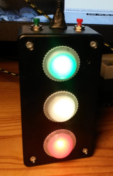

# Tschenggins Lämpli "Chischtli"



Firmware `laempli-chischtli`, sources `fw/src/chain8266/`, `fw/src/ledchain/` and `fw/src/common/`, configuration
`fw/src/chischtli/config.hpp`. The firmware is the same as on the [Chlötzli](../chloetzli/chloetzli.md), only the
configuration is different. The functions of all Lämplis (jobs, serial shell, WiFi, backend, OTA) are in
[laempli.md](../laempli.md).

## Hardware

An ESP8266 board with 3 WS2801 LEDs and a piezo speaker in a black box. Two buttons (green, red) and the USB cable are
on the top. Device ID `chischtli-d54575`.

| Item          | Value                                                         |
|---------------|---------------------------------------------------------------|
| Chip          | ESP8266EX, 26 MHz crystal, MAC 5c:cf:7f:d5:45:75              |
| Flash         | 4 MB (ID 1640e0)                                              |
| USB serial    | CH340, `/dev/serial/by-id/usb-1a86_USB2.0-Serial-if00-port0`  |
| Job LEDs      | 3 WS2801 on the front                                         |
| LED clock     | GPIO14 (D5)                                                   |
| LED data      | GPIO13 (D7)                                                   |
| Channel order | BRG (bytes on the wire: blue, red, green)                     |
| Status LED    | Onboard LED, GPIO2 (D4), blue, low active                     |
| Piezo         | GPIO4 (D2), see [Melodies](../laempli.md#melodies)            |
| Buttons       | Red: reset. Green: a GPIO (not known), not used               |

The pins are the same as on all old ESP8266 Lämplis (old firmware
[TschengginsLaempli](https://github.com/phkehl/TschengginsLaempli)). Channel order: with RGB (as the Chlötzli), the web
LED test showed red as blue, green as red and blue as green (user, 2026-11-14), thus BRG. Chain order (starts at the
bottom, as the Chlötzli), status LED and speaker: checked by the user.

LED current: the LEDs are the same as on the Chlotz. `config.hpp` has the current model of the Chlotz (measured at
3.3 V, see [Chlotz](../chlotz/chlotz.md#33-v-supply-and-current-limit)): per pixel 0.6 mA idle, red 18 mA, green
11 mA, blue 10 mA at 255. Thus 3 white LEDs at full brightness use about 120 mA, below the limit `LED_MAX_MA`
(200 mA): the limit has no effect. The LED supply voltage of the Chischtli is not known; at 5 V the current can be a
bit higher.

Power: with the old firmware, the USB serial port went away and came back about each 3 s. The
new firmware did the same at the first WiFi connect tries, then it was stable. Use a good USB port and cable.

Warning: the Hello and the Chlötzli have the same USB serial type and the same by-id path. There is no serial number.
When more than one is connected, the path goes to the last one connected. Before you flash, check the MAC with esptool:

```sh
fw/.venv/bin/python fw/.pio-core/packages/tool-esptoolpy/esptool.py --port /dev/serial/by-id/usb-1a86_USB2.0-Serial-if00-port0 read_mac
```

## Firmware

As the [Chlötzli](../chloetzli/chloetzli.md#firmware): job LEDs (reverse LEDs default on: LED 1 at the top), synced
settings (name, LED brightness, animations, reverse LEDs), job sounds (melodies), firmware update on the device page or
with `ota install` (no rollback on the ESP8266), status on the onboard LED.

First setup in a serial terminal (`fw/.venv/bin/pio device monitor -d fw -e laempli-chischtli`): `wifi scan`,
`wifi add`, `backend url https://...`, `backend auth`, optional `name <name>`. Commands: see
[Serial shell](../laempli.md#serial-shell), and the `led` commands of the Stägge
([Stägge](../staegge/staegge.md#firmware)).

Flash (first time, or if OTA does not work):

```sh
fw/.venv/bin/pio run -d fw -e laempli-chischtli -t upload
```

Heap after the start, without WiFi: 27.8 kB free, 26.8 kB largest block (2026-11-14).

## Old firmware

The device came with the old firmware [TschengginsLaempli](https://github.com/phkehl/TschengginsLaempli). It was not
kept (flash erased 2026-11-14).
