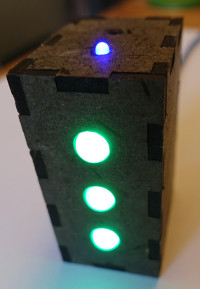

# Tschenggins Lämpli "Chlötzli"



Firmware `laempli-chloetzli`, sources `fw/src/chain8266/`, `fw/src/ledchain/` and `fw/src/common/`, configuration
`fw/src/chloetzli/config.hpp`. The [Chischtli](../chischtli/chischtli.md) has the same code. The functions of all Lämplis (jobs, serial shell, WiFi, backend, OTA) are in
[laempli.md](../laempli.md).

## Hardware

An ESP8266 board with WS2801 LEDs in a wood box. Device ID `chloetzli-1ee4d5`.

| Item          | Value                                                        |
|---------------|--------------------------------------------------------------|
| Chip          | ESP8266EX, 26 MHz crystal, MAC 60:01:94:1e:e4:d5             |
| Flash         | 4 MB (ID 1640e0)                                             |
| USB serial    | CH340, `/dev/serial/by-id/usb-1a86_USB2.0-Serial-if00-port0` |
| Job LEDs      | 3 WS2801 on the front, the chain starts at the bottom        |
| LED clock     | GPIO14 (D5)                                                  |
| LED data      | GPIO13 (D7)                                                  |
| Channel order | RGB                                                          |
| Top LED       | Onboard LED, GPIO2 (D4), blue, low active                    |
| Piezo         | GPIO4 (D2), see [Melodies](../laempli.md#melodies)           |

Pins, channel order, chain order and top LED: seen by the user with the LED test (below). Speaker: heard by the user.
The LED current is not measured: `config.hpp` has the current model of the Stägge strip. With that model, 3 white LEDs
at full brightness are about 170 mA, so the limit `LED_MAX_MA` (300 mA) has no effect.

Warning: the Hello has the same USB serial type and the same by-id path. There is no serial number. When both are
connected, the path goes to the last one connected. Before you flash, check the MAC with esptool (Hello:
5c:cf:7f:3a:9a:d3).

## Firmware

| LED          | Function                                        |
|--------------|-------------------------------------------------|
| Front top    | LED 1 on the device page (reverse LEDs on)      |
| Front middle | LED 2                                           |
| Front bottom | LED 3 (reverse LEDs on)                         |
| Top          | System status, see below                        |

The job LEDs work as on the Chlotz (same code, `fw/src/ledchain/`, see [Job LEDs](../chlotz/chlotz.md#job-leds)). Synced
settings (web page or serial terminal): the name, the LED brightness, the animations and reverse LEDs (`led reverse
[on|off]`, default on; off: LED 1 at the bottom). Job sounds: melodies, set on
the device page (no sound effect module). Firmware update: button "Update firmware" on the device page, or `ota
install`. There is no rollback on the ESP8266.

The top LED shows the system status:

| Light                        | Status                                                                             |
|------------------------------|------------------------------------------------------------------------------------|
| Heartbeat (2 flashes, pause) | Connected to the backend                                                           |
| Slow blink (1 s on, 1 s off) | WiFi or backend connects, firmware update runs                                     |
| Fast blink (5 Hz)            | No WiFi network or URL, connection error, certificate not trusted, no data in time |

First setup in a serial terminal (`fw/.venv/bin/pio device monitor -d fw -e laempli-chloetzli`): `wifi scan`,
`wifi add`, `backend url https://...`, `backend auth`, optional `name <name>`. Commands: see
[Serial shell](../laempli.md#serial-shell), and the `led` commands of the Stägge
([Stägge](../staegge/staegge.md#firmware)).

HTTPS: as the Hello ([HTTPS and OTA on the ESP8266](../hello/hello.md#https-and-ota-on-the-esp8266)), but with a TLS
receive buffer of 8 kB, a message buffer of 6 kB for 3 LEDs, and firmware update parts of 2 kB. Heap after the start,
without WiFi: 28.0 kB free. Heap with a TLS connection to the backend and 3 jobs, after a restart: 15.0 kB free,
12.2 kB largest block. Lowest free heap
during the first state message (3 jobs): 9.2 kB (2026-11-06). The ESP8266 has no lowest free counter: the firmware
samples the free heap at the points of high use (message parsed, LED state, TLS connect, report) and `status` shows the
lowest value.

## Old firmware

The device came with the old firmware [TschengginsLaempli](https://github.com/phkehl/TschengginsLaempli) (version
992339c1M, 2020-02-03).

## LED test

`tools/test/ws2801-order/` is a small test program. It sends the raw bytes (no LED library), so byte 1 is the first byte
on the wire for each pixel. Build and flash in the repo root:

```sh
fw/.venv/bin/pio run -d tools/test/ws2801-order -t upload
```

The test runs in a loop, about 22 s for one loop. The serial port (115200 baud) shows each step:

1. Channel order: all LEDs blink in one byte only. Byte 1 blinks once, byte 2 twice, byte 3 three times. The colours
   give the order.
2. Chain order: pixel 1, 2, 3 and 4 are white, 2 s each. Pixel 4 shows if the top LED is a fourth pixel in the chain.
3. Onboard LED: the WS2801 LEDs are off, GPIO2 is on for 2 s.

Result (user, 2026-10-31): 1 blink red, 2 blinks green, 3 blinks blue: RGB. White starts at the bottom. The top LED
lights only in step 3.
