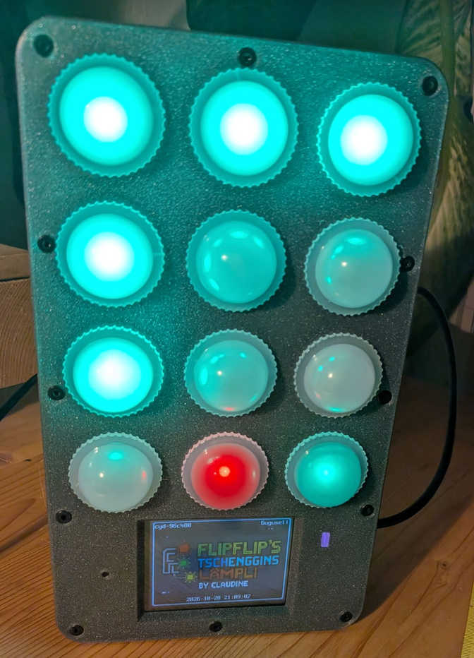
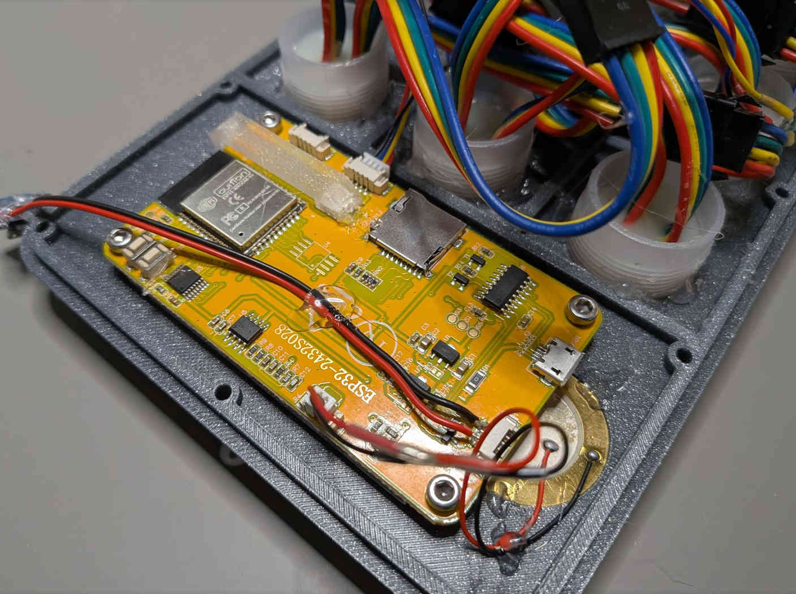
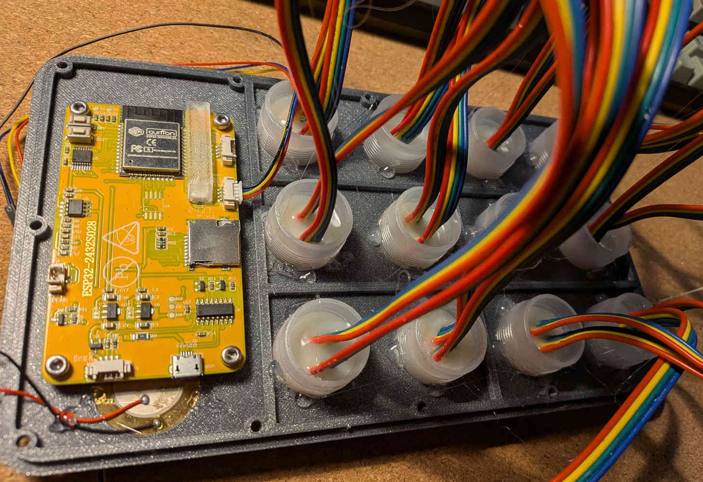

# Tschenggins Lämpli "Chlotz"







ESP32 "Cheap Yellow Display" (CYD) board with display and touch, and 12 WS2801 LEDs in a 3D printed enclosure.
Firmware `laempli-chlotz`, sources `fw/src/chlotz/`, `fw/src/ledchain/` and `fw/src/common/`, configuration
`fw/src/chlotz/config.hpp`. The functions of all devices (jobs, serial shell, WiFi, backend, OTA) are in
[laempli.md](../laempli.md).

Files in this directory:

| File                                       | Content                                                      |
|--------------------------------------------|--------------------------------------------------------------|
| `ESP32-2432S028-*`                         | CYD hardware docs: schematic, pinout, specifications, size  |
| `TschengginsLämpli-chlotz.3mf`, `.step`    | Enclosure                                                    |
| `TschengginsLämpli-chlotz-lightguide.3mf`  | Light guide for the onboard RGB LED                          |
| `TschengginsLämpli-chlotz.jpg`             | Enclosure picture                                            |
| `chlotz1.jpg` ... `chlotz3.jpg`            | Photos                                                       |

## Hardware

- ESP32-2432S028 "Cheap Yellow Display" (CYD), with ILI9341 320x240 display
- WS2801 RGB LED pixels, "large 26 mm milky round" type. They have 4-pin connectors (one male, one female)
  to daisy chain them.

The LED pixels work at 3.3 V and also at 5 V (WS2801: 3.3-5.5 V). The Chlotz powers them from the CN1 3.3 V pin.
At 3.3 V, green and blue are dimmer than at 5 V, which is still bright enough.

LED pixel wires:

| Wire   | Function   |
|--------|------------|
| Red    | VCC        |
| Yellow | Data (DI)  |
| Green  | Clock (CI) |
| Blue   | GND        |

Wiring, using the CN1 connector (JST 1.25 mm, 4 pins, "temp humidity interface"):

| CN1 pin | CYD signal | LED wire        | Note                                         |
|---------|------------|-----------------|----------------------------------------------|
| 1       | 3.3V       | Red (VCC)       | Max. 200 mA for LEDs, see below              |
| 2       | GPIO27     | Yellow (data)   | Has 10k pull-up on the CYD                   |
| 3       | GPIO22     | Green (clock)   | Also on P3 connector                         |
| 4       | GND        | Blue (GND)      |                                              |

Connect the CYD to the input end of the chain (DI/CI side). Do not use P3 GPIO21 (it controls the display backlight)
or GPIO35 (input only).

### 3.3 V supply and current limit

- CN1 3.3 V comes from regulator U1 (AMS1117-3.3). U1 also powers the display, touch controller and SD card. The
  ESP32 has its own regulator (U7).
- U1 dissipates (5 V - 3.3 V) * I. Without a heat sink, about 300 mA (0.5 W) is safe. The display backlight uses
  about 50-100 mA of this.
- Everything comes from USB through diode D1. A USB 2.0 port gives 500 mA for the whole board.
- The firmware estimates the LED current from the RGB values and lowers the brightness to stay below `LED_MAX_MA`
  (200 mA: with the backlight, U1 stays at about 300 mA). Full white on all 12 LEDs is then about scale 105 of 255.
  The current model (`LED_IDLE_UA`, `LED_RED_UA`, ...) is measured: per pixel 0.6 mA idle, red 18 mA, green 11 mA,
  blue 10 mA at 255 (39 mA full white). The current is linear with the value. Measured with a USB meter (CYD input
  current with and without LEDs on), shell `led <r> <g> <b>`. A multimeter in series with the 3.3 V LED wire gives
  much too low values: its shunt lowers the LED voltage.
- The shell `status` shows the estimated current.

### Speaker

A piezo speaker on the connector P4 "SPEAK" (JST PH 2.0, 2 pins). GPIO26 drives it through a low pass filter and the
amplifier SC8002B (always on, gain about 3). The firmware makes a square wave with the LEDC (channel 4, `SPEAKER_...`
in `fw/src/chlotz/config.hpp`).

### 5 V supply (alternative)

- Use a separate 5 V supply for the LEDs (up to 60 mA per LED at full white). Connect its GND to the CYD GND.
- WS2801 needs 0.7 * VDD = 3.5 V as logic high. 3.3 V often works but is out of spec. For reliable operation
  use a level shifter (e.g. 74AHCT125 or 74HCT245, powered from 5 V) on data and clock.

## Job LEDs

Each LED shows one job (see [LEDs: job status](../laempli.md#leds-job-status)). Before the first state from the
backend (after start), all LEDs blink white. If the backend connection breaks, the LEDs keep the last state for 5
minutes, then they blink in the colour of the last result. Colours and periods are in `fw/src/chlotz/config.hpp`.

Each LED animates on its own: its animation starts when its status changes, so the LEDs are not in phase.

Animations (see the list in [laempli.md](../laempli.md#leds-job-status)): select them in Display settings (the rows
"Running" and "Waiting" open a list, a tap on an animation selects it) or with the shell command
`led anim running|waiting <n>`. The setting is saved. The LED test shows each of them (steps "Animation <n>").
`LED_ANIM_RUNNING` and `LED_ANIM_WAITING` in `fw/src/chlotz/config.hpp` set the default. The LEDs run in their own task
at 100 frames/s, independent of the display. Levels are gamma corrected (`LED_GAMMA`), and the output dithers (the
rest below one LED step goes to the next frame), so slow fades are smooth also at the low global brightness.

LED brightness: the global brightness of the job LEDs (and of the rainbow demo and the LED test), a setting: Display
settings, row "LED brightness" (a list), or the shell command `led brightness [<value>]` (1-255). The setting is saved,
default `LED_BRIGHTNESS` (64) in `fw/src/chlotz/config.hpp`. The current limit (200 mA) applies on top:

| Brightness       | Value (of 255) | All 12 LEDs white, about  |
|------------------|----------------|---------------------------|
| very dim         | 16             | 37 mA                     |
| dim              | 32             | 66 mA                     |
| medium (default) | 64             | 125 mA                    |
| bright           | 96             | 183 mA                    |
| very bright      | 128            | 200 mA (limit, scale 105) |
| brightest        | 160            | 200 mA (limit, scale 105) |

## Onboard RGB LED: device state

The RGB LED on the CYD board (GPIO4 red, GPIO16 green, GPIO17 blue, active low) shows the device state. It is always
animated, so one sees that the device runs. The colours mix the LEDs (bright through the light guide):

| Light                         | Meaning                                                                         |
|-------------------------------|---------------------------------------------------------------------------------|
| mint green, breathes (3 s)    | Connected to the backend                                                        |
| orange, breathes fast (1 s)   | Problem: no WiFi or backend configured, connecting, connection error, no data   |
|                               | from the backend in time, certificate not trusted                               |
| bright blue, blinks fast      | Firmware update runs                                                            |
| white flash                   | Activity: change of the LED state (status, result, info, names, LED config),    |
|                               | settings from the web page                                                      |

Colours and times: `BOARD_LED_...` in `fw/src/chlotz/config.hpp`. Details: `fw/src/chlotz/boardled.cpp`.

## Display and touch

- Driver: [LovyanGFX](https://github.com/lovyan03/LovyanGFX), configured in `fw/src/chlotz/display.cpp`. ILI9341
  display on HSPI, XPT2046 touch on VSPI.
- Font: [Spleen](https://github.com/fcambus/spleen) 8x16, monospaced pixel font (BSD-2), from
  [U8g2](https://github.com/olikraus/u8g2). Landscape gives 40 columns and 15 rows.
- Touch calibration: hold the BOOT button while the Chlotz starts (reset or power on), then touch the four arrows. The
  calibration is saved in NVS.
- Dimming: after the dim timeout without touch, the backlight goes to the dim level. A tap restores full
  brightness (this tap does not press a button).

Main screen:

```
+--------------------------------------------------------+
| Tschenggins Lämpli                         SSID  ▂▄▆█  |
|--------------------------------------------------------|
| ●  1 RUNNING PASS    release-config feat               |
| ●  2 WAITING FAIL    Yocto scarthgap                   |
| ●  3 STOPPED PASS    fpxx main                         |
| ●  4 OFF                                               |
| ...                     (12 rows)                      |
|--------------------------------------------------------|
| connected            2026-10-23 01:23:45           [≡] |
+--------------------------------------------------------+
```

- Screensaver: after the screensaver timeout (Display settings, default 60 s, 0 = never) on the main screen without
  touch and without a change of an LED status or result, the logo shows with the device ID (top left), the device name
  (top right) and the date and time (hh:mm:ss) at the bottom. Not in the settings screens. A touch (it only ends the
  screensaver) or a status or result change shows the main screen again, and the timeout starts again.
- Header: title, SSID (first 16 chars) and 1-4 signal bars. The SSID blinks while connecting. The device ID and name
  show on the logo (after start and "About").
- Content: one row per LED (12): its colour, the LED number (1-12), the status, the result (in its colour) and the label
  (name from the web page, else the job path without the source; 19 chars). "OFF": LED unused, "-": no state from
  the backend yet. A tap on a row shows the LED details: source and path, status, result, time of the
  last change, and up to 4 info lines from the source (e.g. pipeline, commit, user), with [Back] [Prev] [Next].
- Status line: backend connection state in colour (green: connected; yellow: connecting, no heartbeat, not
  configured; red: no network, errors, certificate not trusted) and the local date and time. The time comes from the
  backend (heartbeat every 15 s). It blinks if no data came for heartbeat + 5 s.
- [≡] opens the settings menu: Device (Name, WiFi networks, Backend, Firmware/Update, Reverse LEDs), Display, Test
  (LED test, Rainbow demo, Melodies), and the buttons [Back] [About]. After 5 minutes without touch, the Chlotz goes back to the main
  screen (open input is discarded).
- LED test: a sequence of test patterns, with [Back] [Prev] [Play/Pause] [Next]. Play goes to the next step after the
  step time (1-5 s), pause keeps the step (animations keep running). Steps: all off, red, green, blue, white; white
  levels 1, 2, 4, ... 255; brightness ramp (scale 0-255); colour wheel; rainbow (LED order); running light; each
  animation (8 s, LED 1, 2, 3, 4 in green, red, yellow, white); each LED alone (LED 1, 2, ...).
  The screen shows the step, the estimated current and the LED colours. The current limit applies. The test stops when
  the screen closes.
- Rainbow demo: a moving rainbow on the LEDs, with the estimated current and the LED colours. It stops when the screen
  closes; then the LEDs show the job status again.
- Melodies: the built-in melodies (see [Melodies](../laempli.md#melodies)), with [Back] [Up] [Down] [Stop]. A tap
  plays a melody; the one that plays has a yellow frame. The melody stops when the screen closes.
- After start, the logo (`fw/src/chlotz/logo.png`, embedded in the firmware) shows for 5 s, with the device ID (top
  left), the device name (top right) and the firmware name and version (bottom left, two lines). "About" shows it again;
  a tap goes back to the menu.

## Settings

All settings are saved in NVS. Change them on the Chlotz ([≡]) or in a serial terminal (see
[Serial shell](../laempli.md#serial-shell)). The menu entries and the commands:

| Serial command                    | Chlotz                            | Function                                    |
|-----------------------------------|-----------------------------------|---------------------------------------------|
| `status`                          | main screen                       | WiFi, backend, LED state, free heap         |
| `config`                          |                                   | Show all settings                           |
| `name [<name>\|-]`                | Device > Name                     | Device name (25 chars), `-` = none          |
| `wifi list`                       | Device > WiFi networks            | Configured networks (tried in this order)   |
| `wifi scan`                       | Device > WiFi networks > Add      | Networks in range                           |
| `wifi add`                        | Device > WiFi networks > Add      | Add network or change password              |
| `wifi del <n>`                    | Device > WiFi networks > Del      | Delete network                              |
| `wifi move <n> <m>`               | Device > WiFi networks > Up/Down  | Change order                                |
| `wifi reconnect`                  |                                   | Start new connect round                     |
| `backend url <url>`               | Device > Backend > URL            | Backend URL (`http(s)://...`), `-` = none   |
| `backend auth`                    | Device > Backend > User, Password | HTTP basic auth (empty user = no auth)      |
| `backend insecure on\|off`        | Device > Backend > Check cert.    | Certificate check off or on                 |
| `backend reconnect`               | Device > Backend > Reconnect      | Reconnect now                               |
| `display dim <seconds> <percent>` | Display > Dim                     | Dim timeout (0 = never) and dim level       |
| `display saver <seconds>`         | Display > Screensaver             | Screensaver timeout (0 = never)             |
| `ota`                             | Device > Firmware/Update          | Firmware version and update state           |
| `ota install`                     | Device > Update: ...              | Install newer firmware from the backend     |
| `led <r> <g> <b> [scale]`         | Test > LED test                   | All LEDs one colour, to measure the current |
| `led off`                         | Test > LED test                   | All LEDs off (test)                         |
| `led demo`                        | Test > Rainbow demo               | Rainbow demo                                |
| `led normal`                      | -                                 | Back to normal output (job status)          |
| `led anim`                        | -                                 | Show the RUNNING and WAITING animations     |
| `led anim running\|waiting <n>`   | Display > Running, Waiting        | Use animation n for the job LEDs            |
| `led brightness [<value>]`        | Display > LED brightness          | LED brightness (1-255), no value: options   |
| `led reverse [on\|off]`           | Device > Reverse LEDs             | LEDs other way, display turned 180°         |
| `melody`                          | Test > Melodies                   | Show the built-in melodies                  |
| `melody <n>\|<name>`              | Test > Melodies                   | Play a melody                               |
| `melody stop`                     | Test > Melodies > Stop            | Stop the melody                             |

WiFi: Device > WiFi networks > "Add" scans; tap a network in range, or "Type SSID..." for a hidden network.

Synced settings (also on the web page, see [Backend](../../backend/backend.md)): the name, dim after, dim level,
screensaver after, LED brightness, the LED animations of RUNNING and WAITING, and reverse LEDs.

Reverse LEDs: the LED chain goes the other way, and the picture and the touch turn by 180°. Use it when the Chlotz
stands with the display at the top. The touch calibration stays good. The main screen keeps the LED numbers.

## Backend connection and HTTPS

HTTPS (WebSocket through Apache, 2026-10-27: about 91-97 kB heap free, lowest 76-80 kB): the firmware has the root CA
certificates of the Debian package ca-certificates (`/etc/ssl/certs/ca-certificates.crt`). `tools/gen_ca_bundle.py`
converts them at build time. If the certificate check fails, the Chlotz asks once if it may connect without the check
("not secure"); the terminal prints a hint.

The TLS connect took about 5-5.5 s with the ECDSA certificate chain (2026-10-28, log line "Backend: connect took ...
ms"), 1.8 s with the RSA chain (Stägge, 2026-11-11, see [Backend connection](../laempli.md#backend-connection)).
Benchmark of the ECDSA handshake on the ESP32 (3.9 s without the other tasks): certificate 2.7 s (3 x P-384 verify,
770 ms each), server key exchange 0.6 s (P-256 signature), client key exchange 0.5 s (x25519). An RSA verify takes
only a few ms (hardware). The certificate check does not yield on core 0 for some seconds, up to the limit of the task
watchdog of the idle task of core 0 (5 s). Thus the firmware
does not watch that idle task during the TLS connect (`tlsWatchdog()` in `fw/src/common/backend.cpp`). Without this, one
more task (the melody player) made the watchdog reset the ESP32 at each connect.

Before 2026-10-27 the Chlotz used a Server-Sent Events (SSE) stream and a second connection for the reports. With
HTTPS, the second TLS handshake ran out of heap ("MPI alloc failed" in the certificate check), so the reports failed.

## Firmware update (OTA)

If the backend has a newer firmware, the Chlotz asks ([Later] [Install]); Device > Update, `ota install` and the button
"Update firmware" on the device page of the backend can start it later. The update gets the file from the backend
(on the WebSocket connection, see [Firmware version and update](../laempli.md#firmware-version-and-update-ota)) into
the other app partition, checks the MD5 and restarts. The display shows the progress.

Rollback: a new firmware is valid only after its first connection to the backend. If it restarts before that (crash,
reset, power off), the bootloader starts the old firmware again.

Partition table `min_spiffs.csv`: 1.9 MB per app partition (OTA possible).

## Build and flash

```sh
fw/.venv/bin/pio run -d fw -e laempli-chlotz -t upload    # build and flash (upload_port in fw/platformio.ini)
fw/.venv/bin/pio device monitor -d fw -e laempli-chlotz   # serial terminal
```

Change the configuration (pins, number of LEDs, brightness, current limit and model, defaults) in
`fw/src/chlotz/config.hpp`.

## References

- https://mischianti.org/esp32-2432s028-cheap-yellow-display-high-resolution-pinout-datasheet-schema-and-specs/
- https://github.com/witnessmenow/ESP32-Cheap-Yellow-Display
