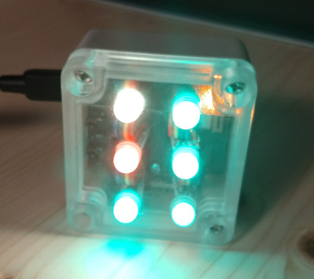
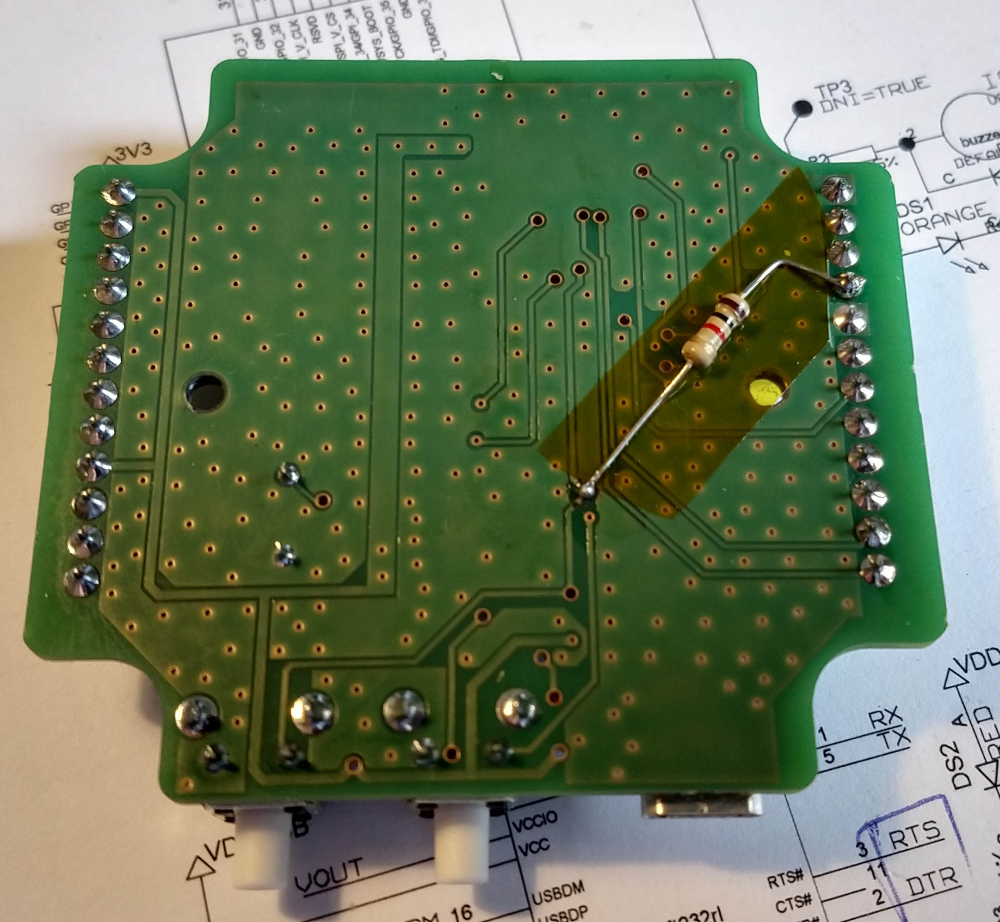

# Tschenggins Lämpli "Gitta"



Firmware `laempli-gitta`, sources `fw/src/gitta/`, `fw/src/ledchain/` and `fw/src/common/`, configuration
`fw/src/gitta/config.hpp`, partition table `fw/partitions-gitta.csv`. The functions of all Lämplis (jobs, serial
shell, WiFi, backend) are in [laempli.md](../laempli.md). The Gitta has no firmware update over the backend (OTA): use
USB, see [Flash memory](#flash-memory-no-ota).

## Hardware

A self-made board (2019) with a u-blox NINA-W102 module (ESP32), 6 WS2801 LEDs in 2 columns of 3, a speaker, in a
clear box. There are two Gittas. The old README says: "a broken design", there are no board files.

| Device ID      | MAC               | USB serial (FT232R serial number)                                  |
|----------------|-------------------|--------------------------------------------------------------------|
| `gitta-87e984` | 3c:71:bf:87:e9:84 | `/dev/serial/by-id/usb-FTDI_FT232R_USB_UART_A1070NAB-if00-port0`   |
| `gitta-87e94c` | 3c:71:bf:87:e9:4c | `/dev/serial/by-id/usb-FTDI_FT232R_USB_UART_A1070N9V-if00-port0`   |

| Item          | Value                                                                       |
|---------------|-----------------------------------------------------------------------------|
| Module        | u-blox NINA-W102                                                            |
| Chip          | ESP32-D0WDQ6 rev 1.0, 2 cores, 40 MHz crystal                               |
| Flash         | 2 MB (ID c2 2815), DIO                                                      |
| USB serial    | FTDI FT232R (see above)                                                     |
| Reset, boot   | Automatic with RTS and DTR (esptool), also buttons SW1 (reset), SW2 (boot)  |
| Job LEDs      | 6 WS2801, 2 columns of 3                                                    |
| LED clock     | GPIO18 (header "CI")                                                        |
| LED data      | GPIO19 (header "DI")                                                        |
| Channel order | RGB                                                                         |
| Status LED    | GPIO26, orange (DS1), high active                                           |
| Speaker       | GPIO27, see [Melodies](../laempli.md#melodies)                              |
| Not used      | GPIO25 ("fx" in the old firmware)                                           |

Pins: from the old firmwares (below). Channel order and chain order: seen by the user with a test pattern
(2026-11-12). The LED current is not measured: `config.hpp` has the current model of the Stägge strip. With that model,
6 white LEDs at full brightness are about 340 mA, thus the limit `LED_MAX_MA` (300 mA) lowers the brightness a little.

Pins of the board, seen from the top (from the old README):

```
The numbers are:      +--------------------------------+           o = input/output
ESP32 GPIO (NINA pin) |     +--------+                 |           x = input only
                      |  26-|        |                 |           s = power supply, ground
                +-----+ (17)|  NINA  |                 +-----+
                |       /   |  W102  |                       |
            GND | s---LED   |        |                     s | 3V3
        (16) 25 | o         +--------+                     o | 21 (8)
        (20) 22 | o                                        o | 33 (7)
            3V3 | s                                        o | 32 (5)
            GND | s                                        x | 36 (4)
        (21) 19 | o DI                 27 (18)             x | 39 (3)
        (29) 18 | o CI     1 (22) TX      \ ___            x | 34 (2)
        (24)  4 | o        3 (23) RX       /   \           o | 23 (1)
        (25)  2 | o boot    +---+         | buz |          s | 3V3
        (36) 12 | o         | F |          \___/           o | 14 (31)
        (35) 13 | o         | T |          /               o | 15 (32)
        (34) 35 | x         | D |       GND                o |  5 (28)
                |           | I |                            |
                +-----+     +---+        (19)   0 (27) +-----+
                      |      /          reset    boot  |
                      |    USB           SW 1    SW 2  |
                      +--|_____|--------|____|--|____|-+
                                          ||      ||
```

Free GPIOs: 2 4 5 12 13 14 15 21 22 23 32 33 (GPIO16 and 17 are not on the NINA module).

The board has a fix on the bottom side (old commit "fix for GITTA board (?)", 2020): a resistor from a pin of the left
header (the 4th from the top, seen from the top: 3V3) to a via, under tape. Its function is not known.



## Firmware

| LED                       | Function                                                  |
|---------------------------|-----------------------------------------------------------|
| Top left                  | LED 1 on the device page (reverse LEDs on: LED 6)         |
| Top right                 | LED 2 (reverse LEDs on: LED 5)                            |
| Middle left, middle right | LED 3, LED 4                                              |
| Bottom left, bottom right | LED 5, LED 6 (reverse LEDs on: LED 2, LED 1)              |
| Status LED (on the board) | System status, see below                                  |

Positions with the USB cable on the left, as in the photo. The LEDs are in reading order. The chain goes down the
left column, then up the right column (`chainIndex()` in `fw/src/gitta/main.cpp`). Reverse LEDs (`led reverse
[on|off]`, default off) turns the LEDs by 180°, for the USB cable on the right. The device page shows the LEDs in 2
columns, in the same order.

The job LEDs work as on the Chlotz (same code, `fw/src/ledchain/`, see [Job LEDs](../chlotz/chlotz.md#job-leds)). Synced
settings (web page or serial terminal): the name, the LED brightness, the animations and reverse LEDs. Job sounds:
melodies on the speaker, set on the device page (no sound effect module).

The status LED shows the system status (as the top LED of the [Chlötzli](../chloetzli/chloetzli.md#firmware)):

| Light                        | Status                                                                             |
|------------------------------|------------------------------------------------------------------------------------|
| Heartbeat (2 flashes, pause) | Connected to the backend                                                           |
| Slow blink (1 s on, 1 s off) | WiFi or backend connects                                                           |
| Fast blink (5 Hz)            | No WiFi network or URL, connection error, certificate not trusted, no data in time |

First setup in a serial terminal (`fw/.venv/bin/pio device monitor -d fw -e laempli-gitta`): `wifi scan`,
`wifi add`, `backend url https://...`, `backend auth`, optional `name <name>`. Commands: see
[Serial shell](../laempli.md#serial-shell), and the `led` commands of the Stägge
([Stägge](../staegge/staegge.md#firmware)). Note: the FTDI holds the ESP32 in reset while RTS is on. A serial program
must open the port with RTS and DTR off (pyserial: set `rts` and `dtr` to False before `open()`).

Build and flash: `fw/.venv/bin/pio run -d fw -e laempli-gitta -t upload`. The upload port in `fw/platformio.ini` is
the one of `gitta-87e984`; for the other Gitta add `--upload-port /dev/serial/by-id/...` (and `--port` for `pio
device monitor`).

Measured 2026-11-12 (production backend, no jobs yet): TLS connect 2.45 s, heap after the connect 157 kB free,
94 kB largest block, lowest free 142 kB.

## Flash memory, no OTA

The ESP32 of the NINA-W102 has only 2 MB flash. The firmware is about 1.08 MB, most of it in the precompiled ESP-IDF
libraries (WiFi and PHY 270 kB, mbedTLS 160 kB, lwIP 100 kB, libc 90 kB), and the CA bundle (68 kB). For a firmware update
over the backend, the flash needs two app partitions; in 2 MB each one has max. 960 kB (apps start at 64 kB steps).
Thus the Gitta has one app partition of 1.88 MB and no OTA (user decision 2026-11-12):

| Partition | Offset   | Size     |
|-----------|----------|----------|
| nvs       | 0x9000   | 20 kB    |
| factory   | 0x10000  | 1.88 MB  |
| coredump  | 0x1F0000 | 64 kB    |

The firmware reports the option `no_ota` (no second app partition, `otaPossible()` in `fw/src/common/compat.hpp`).
The device page then shows "Firmware update only over USB" instead of the button (and the newer version, if there is
one), the backend refuses the update (409), and `ota install` says "use USB".

## Old firmware

The device came with the ESP-IDF firmware "gitta" (from the [gitta](https://github.com/phkehl/gitta) repository,
version 2062db0, 2019-10-07, ESP-IDF v3.3, one factory app of 1 MB). The Arduino firmware
[TschengginsLaempli](https://github.com/phkehl/TschengginsLaempli) also has the Gitta (model "gitta", target
`esp32-gitta`). The firmware of `gitta-87e94c` was not checked before the erase. Copies of the old flash (2 MB,
with the old WiFi and backend passwords) are in the git-ignored `data/backup/gitta-<ID>-flash-2026-11-12.bin`.
Restore (example `gitta-87e984`):

```sh
fw/.venv/bin/python fw/.pio-core/packages/tool-esptoolpy/esptool.py \
    --port /dev/serial/by-id/usb-FTDI_FT232R_USB_UART_A1070NAB-if00-port0 write_flash 0 \
    data/backup/gitta-87e984-flash-2026-11-12.bin
```
