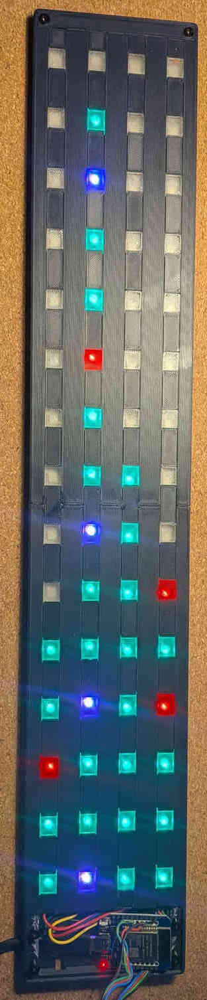
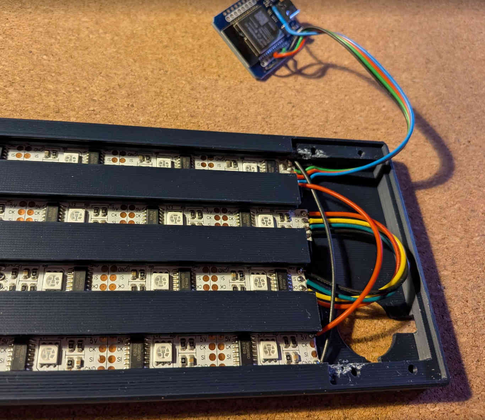
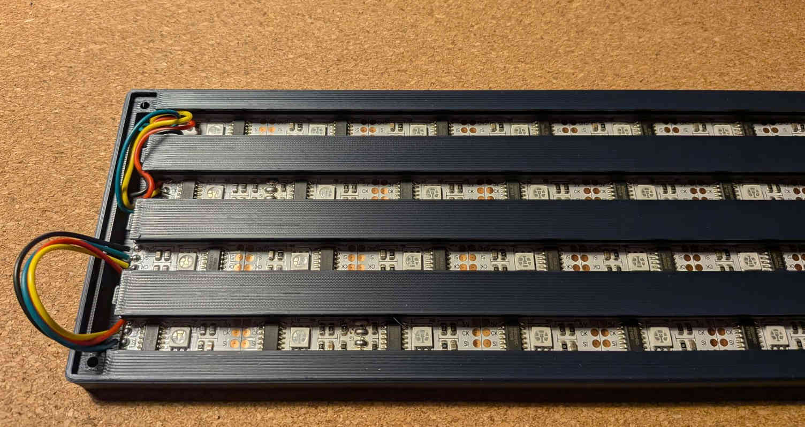

# Tschenggins Lämpli "Stägge"





Lämpli with a Mini D1 ESP32 board and 60 WS2801 LEDs (a strip in 4 rows of 15). Each row shows one project, each
LED of a row one of its pipelines (branch, merge request, ...). No display, no speaker. Work in progress: the firmware
runs, the assignment of the jobs to the LEDs is open.

Firmware `laempli-staegge`, sources `fw/src/staegge/`, `fw/src/ledchain/` and `fw/src/common/`, configuration
`fw/src/staegge/config.hpp`. The functions of all devices (jobs, serial shell, WiFi, backend, OTA) are in
[laempli.md](../laempli.md).

## Board

"Mini D1 ESP32" (also "D1 mini ESP32", "MH-ET LIVE MiniKit"): ESP32-WROOM-32 module on a board with the size of a
Wemos D1 mini. It has two pin rows on each side. One set of pins has the D1 mini layout (D0 ... D8), so D1 mini
shields fit.

Checked 2026-10-28 with esptool (`flash_id`) on `/dev/ttyUSB6`:

| Item         | Value                                                                                   |
|--------------|-----------------------------------------------------------------------------------------|
| Chip         | ESP32-D0WD-V3 (revision v3.1), dual core, 240 MHz, WiFi, BT                             |
| Crystal      | 40 MHz                                                                                  |
| Flash        | 4 MB (manufacturer 0x68, device 0x4016)                                                 |
| MAC          | 8c:4f:00:37:12:b8                                                                       |
| USB serial   | Silicon Labs CP2104, serial number 02HDIEJM                                             |
| Port         | `/dev/ttyUSB6` (2026-10-28), `/dev/ttyUSB0` (2026-10-29), stable path: see below        |
| Firmware     | As delivered: Espressif AT firmware (Wroom32 1.1.2). Now: `laempli-staegge`.            |
| PlatformIO   | `board = wemos_d1_mini32` (variant `d1_mini32`)                                         |
| Onboard LED  | GPIO2, blue, high active (`LED_BUILTIN`)                                                |
| 3.3 V LDO    | SOT-23-5, marking "DE=A1D", probably Richtek RT9193-33GB (300 mA), see [Power](#power)  |

The CP2104 has a serial number. Thus use the `/dev/serial/by-id/...` path: it stays the same when the
`/dev/ttyUSB*` numbers change.

Upload and reset work through the CP2104 (DTR/RTS auto reset). Opening the port with RTS on resets the board.
Opening it with DTR and RTS off (pyserial) sometimes also resets it.

### Blink test

Arduino sketch, built with the PlatformIO core of this project (`fw/.pio-core`) and `espressif32@6.9.0`:

```cpp
void setup()
{
    Serial.begin(115200);
    pinMode(LED_BUILTIN, OUTPUT);
    Serial.printf("blink: LED_BUILTIN=%d\n", LED_BUILTIN);
}

void loop()
{
    static bool on = false;
    on = !on;
    digitalWrite(LED_BUILTIN, on ? HIGH : LOW);
    Serial.printf("led %s\n", on ? "on" : "off");
    delay(500);
}
```

Result: upload OK, the serial output shows `blink: LED_BUILTIN=2` and then `led on` / `led off` each 0.5 s.

## LED strip

- WS2801 strip, cut to 60 pixels (it had 160, counted 2026-10-29 with the LED test `ruler`), in 4 rows of 15 in
  zig-zag: rows 2 and 4 run backwards (see [Job LEDs](#job-leds)).
- Connected to data GPIO23, clock GPIO18 (see below) and to USB VBUS (5 V, a wire on the USB side of the board
  diode). First it was on the 3.3 V pin, then on the VCC pin (see [Power](#power)).
- Colour order: RBG. The strip takes the bytes in the order red, blue, green (found 2026-10-29: the bytes R, G, B
  showed red, blue, green). FastLED: `RBG`.
- Pixels after the end of the data (more pixels than the firmware sends) keep the random state from power-on. Some of
  them can be on and use current. The firmware must send data to all pixels on the strip, or cut the strip.

## Job LEDs

The backend numbers the job LEDs 1-60: row 1 is LED 1-15, row 2 is LED 16-30, row 3 is LED
31-45, row 4 is LED 46-60. LED 1 of each row is on the same side: the firmware reverses rows 2 and 4 for the strip
(`chainIndex()` in `fw/src/staegge/main.cpp`). Checked 2026-10-29 with `led demo`: the same rainbow on each row, all
rows in phase.

Each row shows one project, selected on the device page of the backend (see
[Backend](../../backend/backend.md#led-config)): one LED per pipeline, LED 1 has the oldest pipeline, a pipeline moves
to the new end when a new run starts. Thus a failed branch that stays or keeps running is easy to see, and the number
of LEDs on shows how many things go on in the project. The test source and the generic jobs have no rows. Checked
2026-10-30 with 4 projects: 34 LEDs on, state 18.7 kB, heap 114 kB free (lowest 91 kB), estimated current 205 mA.

Checked 2026-10-30 with a test backend (plain HTTP) and 60 simulated pipelines: state 29 kB and 38 kB (long texts), all
60 LEDs parsed, 14 state changes in 70 s, heap stayed constant, no restart.

Checked 2026-11-08 over TLS: simulated backend behind `tools/backend-proxy.py` (TLS records and certificate chain as in
production, no certificate check), firmware 6e78ebb, after a restart:

| State                                        | Size    | Free heap | Largest block | Lowest free |
|----------------------------------------------|---------|-----------|---------------|-------------|
| Production, 26 LEDs (certificate check)      | 18 kB   | 119.6 kB  | 69.6 kB       | 98.5 kB     |
| Proxy, no LEDs                               | 0.1 kB  | 120.7 kB  | 69.6 kB       | 105.0 kB    |
| Proxy, 60 LEDs                               | 29 kB   | 120.7 kB  | 69.6 kB       | 93.9 kB     |
| Proxy, 60 LEDs, long info                    | 38 kB   | 120.7 kB  | 69.6 kB       | 93.9 kB     |
| Proxy, 60 LEDs, 20 changes (one each 5 s)    | 29 kB   | 120.7 kB  | 69.6 kB       | 93.8 kB     |
| Proxy, 60 LEDs, long branch names (63 chars) | 43 kB   | 120.7 kB  | 65.5 kB       | 92.7 kB     |

The parse of a 60 LED state needs at most about 28 kB below the free heap. The long info does not matter (the filter
skips it), long paths do. In production (about 120 kB free) the lowest free heap thus stays at about 90 kB. The
message buffer (48 kB) is allocated before the TLS connection, so the largest block is not important.

The LEDs show the job states as on the Chlotz: colours, animations and LED brightness levels (see
[laempli.md](../laempli.md#leds-job-status)). Shell `led brightness`, `led anim` or the device settings on the web page
change them.

Current limit: the firmware estimates the LED current from the colours (current model, see
[Current model and limit](#current-model-and-limit)) and lowers the global brightness of all LEDs to stay below
`LED_MAX_MA` (600 mA). Shell `status` shows the estimated current and the used scale. Checked 2026-10-30 with 60
pixels, WiFi and backend connected, LED brightness 64 (white: `led 255 255 255` gives the same):

| All 60 LEDs | Estimate (LEDs only) | Scale | USB meter (total) |
|-------------|----------------------|-------|-------------------|
| Green       | 232 mA               | 64    | 290 mA            |
| Red         | 437 mA               | 64    | 465 mA            |
| Yellow      | 554 mA               | 64    | 560 mA            |
| White       | 599 mA               | 42    | 595 mA            |
| Test pattern (all results and states) | 263-298 mA | 64 | 250-450 mA |

At low load, the meter shows the estimate plus the board (about 60 mA). At high load, the estimate is too high: the
total is below the estimate at white. Thus the limit is on the safe side: the total stays well below the 750 mA budget.
All white happens only before the first state from the backend (blinks), or if all pipelines have no result.

## Firmware

- The LED task (core 1) makes an LED frame each 10 ms: job status (`fw/src/ledchain/ledstatus.cpp`), zig-zag mapping,
  current limit and dithering (`fw/src/ledchain/ledout.cpp`). The backend client has its own task (core 0).
- Onboard LED (GPIO2): blinks until the backend is connected, then off.
- Firmware update: button "Update firmware" on the device page, or `ota install`. A new
  firmware that restarts before its first hello from the backend rolls back to the old one.
- Memory: the backend state of 60 LEDs is about 25 kB (GitLab jobs). Message buffer `BACKEND_DATA_MAX` 48 kB. The
  Stägge keeps no info lines per LED (`LED_INFO_MAX` 0, path max. 63 chars): the parser skips them. Heap after the
  start: 163 kB free.
- Setting "reverse LEDs" (web page, shell): LED 1 of each row is at the other end of the row. The rows stay in place.
- No speaker (`SPEAKER_PIN` -1): no melodies, no job sounds.
- Serial shell: the common commands (see [laempli.md](../laempli.md#serial-shell)) and the `led` commands of the Chlotz:
  `led <r> <g> <b> [scale]`, `led off | demo | normal`, `led anim ...`, `led brightness ...`, `led reverse [on|off]`.
- Build and flash: `fw/.venv/bin/pio run -d fw -e laempli-staegge -t upload` (upload port: the stable CP2104 path).

## LED strip pins

Recommendation:

| Strip wire | ESP32 pin | D1 mini position | Notes                                       |
|------------|-----------|------------------|---------------------------------------------|
| Data (DI)  | GPIO23    | D7               | VSPI MOSI                                   |
| Clock (CI) | GPIO18    | D5               | VSPI SCK                                    |
| GND        | GND       | G                | Also connect to the GND of the LED supply   |
| +V         | see below |                  |                                             |

Why these pins:

- They are the hardware SPI pins (VSPI) of the ESP32. WS2801 is an SPI type protocol (data and clock). The
  firmwares of this project bit-bang the WS2801 (FastLED, 1 MHz), which works on all output pins. With these pins,
  hardware SPI is also possible later.
- They are at the same D1 mini positions (D7 data, D5 clock) as the LED ring of the Hello (Wemos D1 mini, GPIO13 and
  GPIO14). The same cable and wiring plan apply.
- They are not strapping pins, not flash pins and not UART0. They have no special function at boot.

Other good pins (if GPIO18 and GPIO23 are not free): GPIO16, GPIO17, GPIO25, GPIO26, GPIO27, GPIO32, GPIO33.

Do not use these pins for the strip:

| Pins             | Reason                                                                                |
|------------------|---------------------------------------------------------------------------------------|
| GPIO0            | Strapping pin (boot mode), BOOT button                                                |
| GPIO2            | Strapping pin, onboard LED                                                            |
| GPIO5, GPIO15    | Strapping pins (SDIO timing, boot log), signals at boot                               |
| GPIO12           | Strapping pin (flash voltage): a high level at boot can stop the boot                 |
| GPIO1, GPIO3     | UART0 (USB serial: upload, serial shell)                                              |
| GPIO6 ... GPIO11 | Connected to the SPI flash                                                            |
| GPIO34 ... GPIO39| Input only                                                                            |

## Power

Since 2026-10-29 the strip is on USB VBUS (5 V). Before, it was on the 3.3 V pin (the board LDO is too small, see
[3.3 V supply (old)](#33-v-supply-old)) and then on the VCC pin (the board diode is too small, see
[VCC supply (old)](#vcc-supply-old)).

### USB, VBUS and VCC

- USB VBUS goes through a diode near the USB connector to the VCC pin (D1 mini position "5V", next to G) and to the
  3.3 V LDO. VCC is 4.7 V. The board has no VBUS pin: the strip wire is soldered to the USB side of the diode
  (anode, 5.0 V; the cathode with the band is VCC).
- Thus the diode carries only the ESP32 (about 145 mA), the strip current goes directly from USB to the strip. The
  micro-USB connector is rated about 1.8 A.
- USB supply: a USB power adapter with 2.5 A per port. A USB 2.0 port gives only 500 mA, a USB 3.0 port 900 mA.
- Test 2026-10-29 (USB 3.0 port of a docking station): 704 mA total (10 pixels full white) for some minutes. The
  USB voltage went down to 4.83 V, nothing got warm, the ESP32 kept running.
- The WS2801 pixels at 5.0 V read the 3.3 V data and clock signals of the ESP32 correctly: the LED test `ruler` is
  correct up to pixel 160, no flicker (2026-10-29). No level shifter is necessary.
- Optional: 100 ... 470 ohm resistors in series with data and clock (near the board), and a capacitor (for example
  470 uF) across +5 V and GND at the strip input.

### Measurements

Measured 2026-10-29 with a USB power meter at the USB input and the [LED test](#led-test) firmware (no WiFi). All
values are the USB input current. The strip was not cut (160 pixels). The board without the strip uses 60 mA
(see [3.3 V supply (old)](#33-v-supply-old)).

| Strip on VBUS                                                | USB voltage | USB current | Difference |
|--------------------------------------------------------------|-------------|-------------|------------|
| LED test `ruler` (dim pattern on all 160 pixels)             | 5.0 V       | 270 mA      | +88 mA     |
| All 160 pixels off                                           | 5.0 V       | 182 mA      |            |
| 8 pixels red 255                                             | 5.0 V       | 390 mA      | +208 mA    |
| 8 pixels green 255                                           | 5.0 V       | 281 mA      | +99 mA     |
| 8 pixels blue 255                                            | 5.0 V       | 323 mA      | +141 mA    |
| 4 pixels white 255                                           | 4.95 V      | 407 mA      | +225 mA    |
| 10 pixels white 255                                          | 4.83 V      | 704 mA      | +522 mA    |

Results:

- Current per pixel at 255: red 26.0 mA, green 12.4 mA, blue 17.6 mA, white 56.3 mA (sum of the channels:
  56.0 mA). The current is linear with the value (measured at 3.3 V and 4.7 V, white 128).
- The current goes down a little when the USB voltage goes down: 52 mA per pixel white at 4.83 V.
- White looks white (at 3.3 V green and blue get much less current). Colour order: RBG.
- Idle current per pixel: about 0.76 mA ((182 mA - 60 mA) / 160). All 160 pixels idle use about 122 mA all the
  time. Thus cut the strip after the last used pixel.
- Board with WiFi: 145 mA, an upper value (60 mA, plus 85 mA for a WiFi scan, see the 3.3 V measurements).

### Current model and limit

Configuration for the firmware (as on the Chlotz, see [chlotz.md](../chlotz/chlotz.md)):

```cpp
static constexpr EOrder LED_ORDER = RBG;         // Colour order of the pixels
static constexpr uint32_t LED_MAX_MA = 600;      // Max. LED current, USB VBUS
static constexpr uint32_t LED_IDLE_UA  =   760;  // Chip, all channels off
static constexpr uint32_t LED_RED_UA   = 26000;  // Red channel at 255
static constexpr uint32_t LED_GREEN_UA = 12400;  // Green channel at 255
static constexpr uint32_t LED_BLUE_UA  = 17600;  // Blue channel at 255
```

Budget for `LED_MAX_MA` (USB input current):

| Item                                                           | Current       |
|----------------------------------------------------------------|---------------|
| Design limit (user decision 2026-10-29, 2.5 A USB adapter)     | 750 mA        |
| Board with WiFi (upper value)                                  | -145 mA       |
| Rest for the LED pixels, idle included: `LED_MAX_MA` (rounded) | 600 mA        |

Use a USB adapter or a USB 3.0 port: a USB 2.0 port (500 mA) is too weak for this limit.

The firmware estimates the LED current from the RGB values (idle of `LED_NUM` pixels included) and lowers the
brightness to stay below `LED_MAX_MA`. Pixels after `LED_NUM` are not in the estimate: cut the strip.

Number of pixels with all white (the worst case, for example status unknown), the same brightness levels as on the
Chlotz. Per pixel: 0.76 mA + 56 mA * value / 255.

| Brightness       | Value (of 255) | Per pixel, white | Max. pixels at 600 mA | 12 pixels white           |
|------------------|----------------|------------------|-----------------------|---------------------------|
| very dim         | 16             | 4.3 mA           | 140                   | 51 mA                     |
| dim              | 32             | 7.8 mA           | 77                    | 93 mA                     |
| medium (default) | 64             | 14.8 mA          | 40                    | 178 mA                    |
| bright           | 96             | 21.8 mA          | 27                    | 262 mA                    |
| very bright      | 128            | 28.9 mA          | 20                    | 346 mA                    |
| brightest        | 160            | 35.9 mA          | 16                    | 431 mA                    |

The job colours use less: at medium (64), PASS (green) is 3.9 mA per pixel, FAIL (red) 7.3 mA, WARN (orange) 9.2 mA.
With 12 pixels, all brightness levels are without limit, also with all pixels white. Full white (255) on 12 pixels
would be 681 mA: the limit then lowers it to scale 224.

### VCC supply (old)

Second setup: the strip on the VCC pin (4.7 V, behind the board diode).

| Strip on VCC (4.7 V)                                         | USB current | Difference |
|--------------------------------------------------------------|-------------|------------|
| All 160 pixels off                                           | 178 mA      |            |
| Pixels 1, 2, 3 red, blue, green at 255                       | 224 mA      | +46 mA     |
| 8 pixels red 255                                             | 344 mA      | +166 mA    |
| 8 pixels green 255                                           | 252 mA      | +74 mA     |
| 8 pixels blue 255                                            | 281 mA      | +103 mA    |
| 4 pixels white 255                                           | 347 mA      | +169 mA    |
| 8 pixels white 128                                           | 343 mA      | +165 mA    |
| LED test `ruler` (dim pattern on all 160 pixels)             | 245 mA      | +67 mA     |
| 14 pixels white 255 (USB 3.0 port)                           | 700 mA      | +522 mA    |

- Current per pixel at 255: red 20.8 mA, green 9.3 mA, blue 12.9 mA, white 42.3 mA. Idle 0.74 mA. Linear (white 128:
  20.6 mA). Colour order RBG. The 3.3 V signals of the ESP32 work.
- The diode is the limit: at 700 mA it got hot after about 1 minute, and the pixels got less current (37 mA instead
  of 42 mA white). The ESP32 kept running (no reset). On VCC, keep the total at about 450 mA (`LED_MAX_MA` 300).

### 3.3 V supply (old)

First the strip was on the 3.3 V pin of the board. These are the measurements of this setup.

- The 3.3 V LDO of the board is a SOT-23-5 part with the marking "DE=A1D". "DE=" is probably the part code of the
  Richtek RT9193-33GB (300 mA, 3.3 V), "A1D" a date code. Not confirmed: the source is a forum post, not the Richtek
  marking table.
- The LDO dissipates (4.7 V - 3.3 V) * I, thus 0.35 W at 250 mA. A SOT-23-5 part can dissipate only about 0.4 W at
  25 °C (thermal resistance about 250 °C/W with minimum copper). At 250 mA the LDO got quite warm (2026-10-29).

Run 1: the firmware sent data to 150 pixels, thus 10 pixels at the end of the strip had a random colour (constant).
The colour steps are from this run: only the differences to "all off" of the same run are used.

| Run 1 (strip on 3.3 V, no WiFi)                              | USB current | Difference |
|--------------------------------------------------------------|-------------|------------|
| All off (10 random pixels at the end on)                     | 185 mA      |            |
| Pixels 1, 2, 3 red, blue, green at 255                       | 200 mA      | +15 mA     |
| 4 pixels red 255                                             | 235 mA      | +50 mA     |
| 4 pixels green 255                                           | 200 mA      | +15 mA     |
| 4 pixels blue 255                                            | 200 mA      | +15 mA     |
| 4 pixels white 255                                           | 263 mA      | +78 mA     |
| 16 pixels green 255                                          | 236 mA      | +51 mA     |
| 16 pixels blue 255                                           | 250 mA      | +65 mA     |
| 8 pixels white 128                                           | 261 mA      | +76 mA     |

Run 2: the firmware sent data to 300 pixels, all 160 pixels off.

| Run 2 (strip on 3.3 V, 160 pixels off)                       | USB current |
|--------------------------------------------------------------|-------------|
| ESP32 in light sleep                                         | 117 mA      |
| ESP32 on, no WiFi                                            | 170 mA      |
| ESP32 on, WiFi scan (radio on all the time)                  | 255 mA (+-3)|
| Strip disconnected, ESP32 on, no WiFi                        | 60 mA       |

Results:

- Current per pixel at 255: red 12.5 mA, green 3.2 mA, blue 4.1 mA, white 19.5 mA. Linear with the value.
- Green and blue use much less current than red: at 3.3 V these LEDs (forward voltage about 3 V) have little
  voltage headroom. Thus green and blue are less bright than red.
- Idle current per pixel: about 0.7 mA ((170 mA - 60 mA) / 160).
- CP2104, power LED and ESP32 in light sleep: about 7 mA (117 mA - 110 mA).
- ESP32: about 53 mA without WiFi (240 MHz), board 60 mA. WiFi scan adds about 85 mA. The firmwares of this
  project keep the WiFi power save of the Arduino core on (modem sleep), so the normal value is lower. Board with
  WiFi: 145 mA is an upper value.
- Limit on 3.3 V: about 220 mA at the USB input (LDO), thus `LED_MAX_MA` 60 mA, only 10 pixels white at medium.

## LED test

Arduino sketch (FastLED 3.9.4, WS2801, data GPIO23, clock GPIO18, `DATA_RATE_MHZ(1)`, colour order `RGB`), built
like the blink test. It sends 300 pixels (more than the strip), global brightness 255, no dithering. Serial commands
(115200 baud, CR):

| Command                 | Function                                                                       |
|-------------------------|--------------------------------------------------------------------------------|
| (empty line)            | Next measurement step                                                          |
| `step <n>`              | Step n: 0 off, 1 colour order (pixels 1, 2, 3 get R, G, B), 2 ... 8 currents  |
| `c <r> <g> <b> [<n>]`   | First n pixels (default all) one colour, others off (bytes in RGB order)       |
| `p <i> <r> <g> <b>`     | One pixel (index from 0)                                                       |
| `off`                   | All pixels off                                                                 |
| `rainbow <brightness>`  | Rainbow on the first 20 pixels                                                 |
| `ruler`                 | Each 50th pixel green, each 10th red, others dim blue: count the pixels        |
| `sleep`                 | Light sleep for 20 s (the pins keep their levels)                              |
| `wifi`, `wifioff`       | WiFi scan all the time (radio on), WiFi off                                    |

The onboard LED blinks at 1 Hz (off during sleep).
